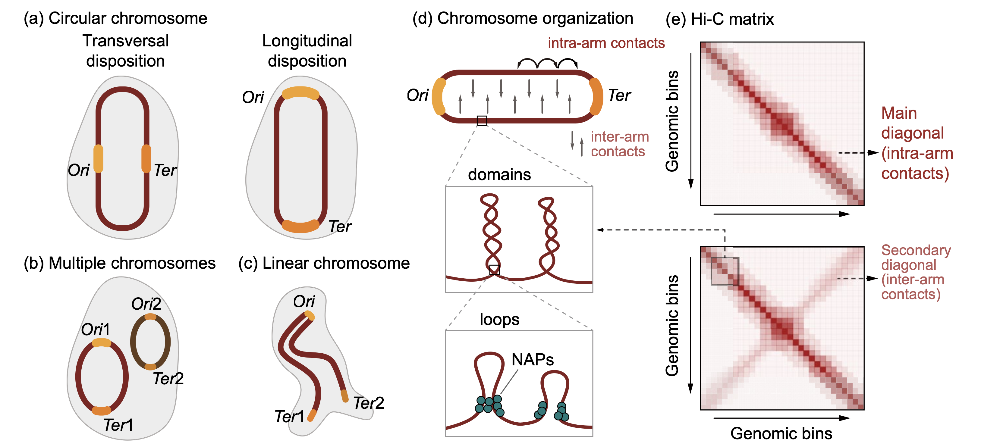
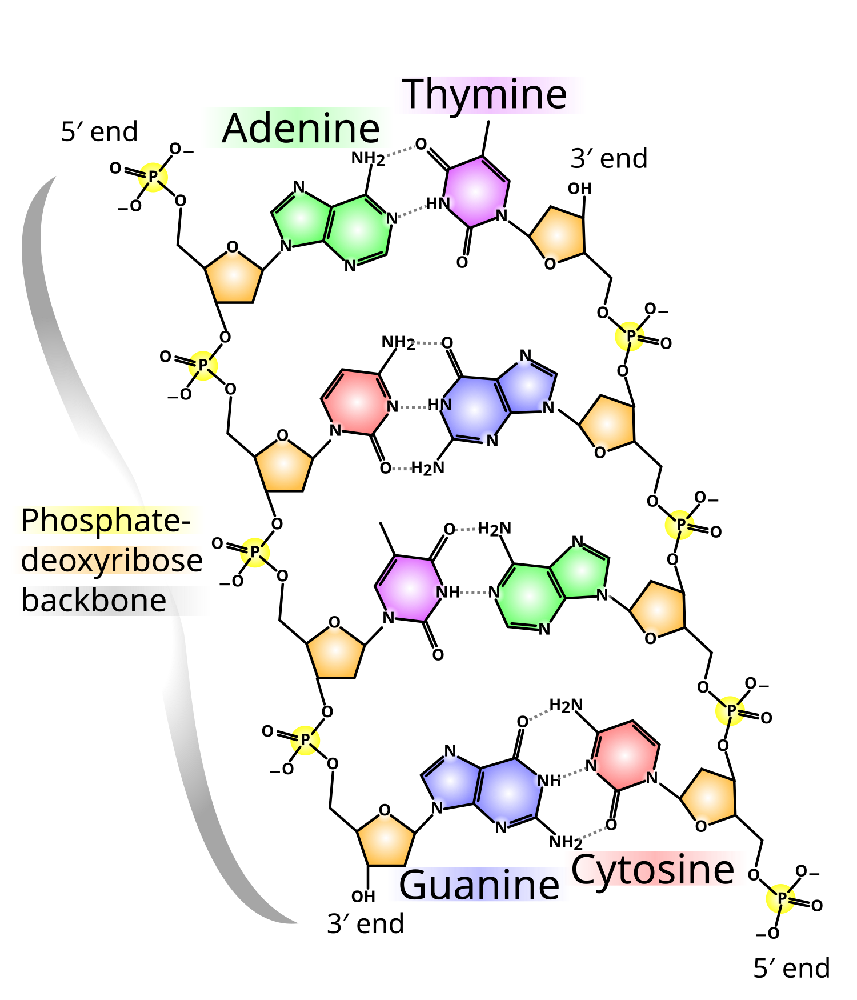
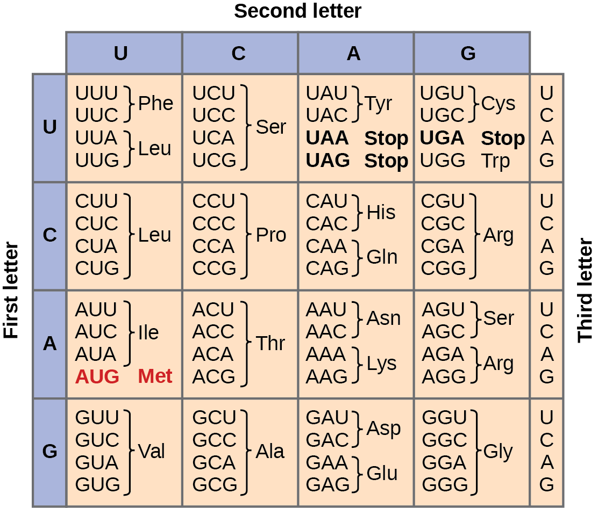
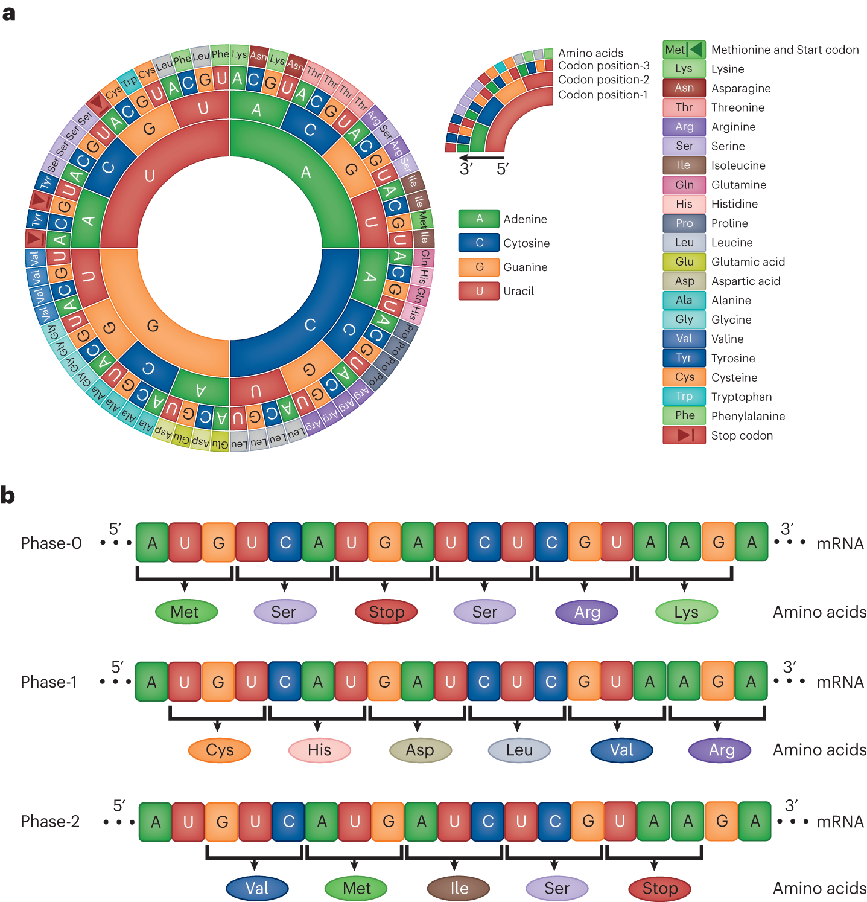
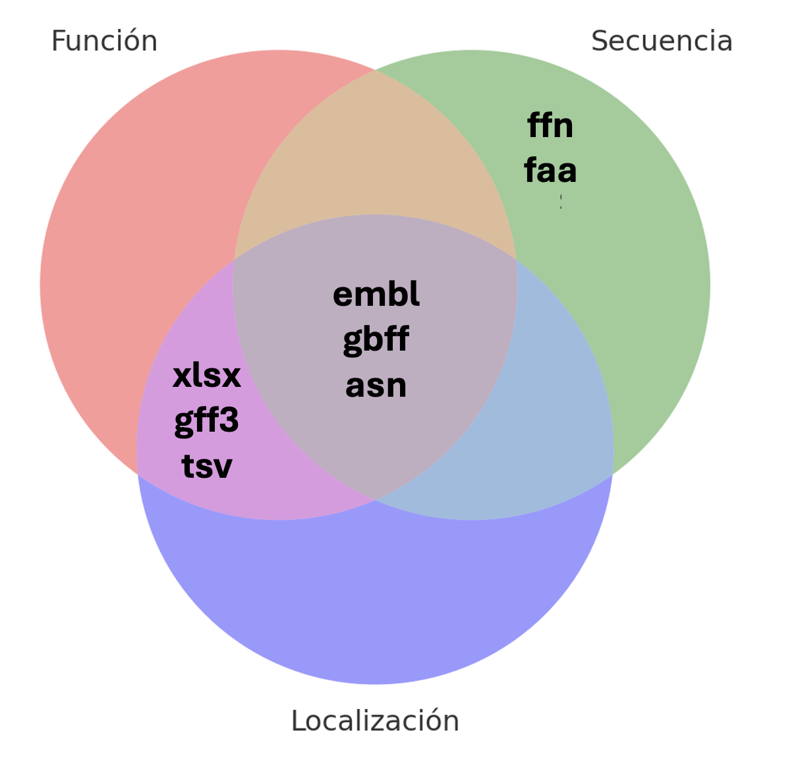
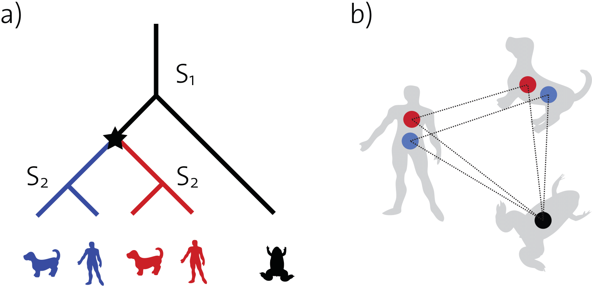

## 01. Predicción de genes y anotación estructural

### 01.1. ¿Qué es la anotación?

La anotación funcional nos permite conocer qué es lo que nuestros microorganismos pueden producir. Es decir, nos permite saber que proteínas, enzimas y metabolitos contienen. A pesar de que comúnmente nos enfocamos únicamente en los genes durante el proceso de anotación, este también nos permite ver varias otras cosas. En general, el proceso de anotación nos ayuda a identificar:

* **Elementos transcribibles:** Genes (llamados CDS), subunidades del RNA ribosomal (como el 16S) y RNA de transporte (tRNA)

* **Elementos de control:** Promotores, sitios de unión de represores/activadores, codones de inicio y paro, secuencias Shine-Dalgarno, terminadores y riboswitches.

* **Elementos de arquitectura:** Secuencias ori y ter y telómeros (en caso de los cromosomas lineales).

* **Elementos móviles:** Transposones, ICEs y profagos.

* **Otros elementos:** Sistemas CRISPR-Cas, pseudogenes y proteínas hipotéticas.

{fig-align="center" width="1044"}

### 01.2. Consideraciones generales

La doble hélice de ADN está conformada por dos cadenas individuales pero complementarias. Estas cadenas están conformadas de nucleótidos, los cuales tienen un azúcar de 5 carbonos como base. En el quinto carbono del anillo de la azúcar, se encuentra siempre un fosfato. En el tercer carbono se encuentra un grupo hidroxilo. Al formarse la cadena de ADN, el extremo del nucleótido A que contiene el grupo fosfato (5’) se una al extremo que tiene el grupo hidroxilo del nucleótido B (3’). Este proceso se repite hasta terminar la cadena, por lo que al final quedan un grupo 5’ y un 3’ libres en los extremos.

En la cadena ”líder” estos extremos van del **5’ -> 3’**

En cadena complementaria, van del  **3’ -> 5’**

{fig-align="center" width="944"}

Esto es importante porque, en general, las bases que nosotros encontramos en nuestros archivos fasta y fastq se encuentran siempre en dirección **5’ -> 3’**.

------------------------------------------------------------------------

# Ejercicios:

::: callout-tip
## Ejercicio 1

**Ahora a te toca a ti**

Vamos a empezar un pequeño ejercicio de anotación. Imaginen que ustedes tienen la siguiente secuencia dentro de su archivo fasta:

**5' - ATGAATCGGTACCTGCGAGCAGTGGTAA - 3'**

¿Cual sería la cadena complementaria?
¿Por qué es importante mantener la dirección constante en nuestros archivos?

Tiempo 5 min
:::

------------------------------------------------------------------------

### 01.3. El código genético

Para crear proteínas, es necesario pasar de la secuencia de nucleótidos (leída siempre en sentido 5’ -> 3’) a una secuencia de aminoácidos. Esto se usando al mRNA como intermediario. Como recordaran, la única diferencia entre el DNA y el mRNA es que este último utiliza la base Uracilo (U) en lugar de Tiamina (T).

Ahora, dado que la cantidad de aminoácidos (al menos 20) es mayor a la cantidad de nucleótidos (sólo 4), es necesario usar combinaciones de 3 nucleótidos para representar cada aminoácido. A la lista de equivalencias de grupos de 3 nucleótidos a aminoácidos es lo que conocemos como el código genético.

Aunque en algún momento se creyó que el código genético era universal, ahora sabemos que existen variantes, pero la gran mayoría de la bacterias usan la variante 11.

{fig-align="center" width="944"}

Durante la anotación es necesario encontrar los marcos de lectura de un gen. Estos están definidos como la secuencia de nucleótidos que se encuentra entre un codón de inicio (AUG, GUG o UUG) y un codón de paro (UAA, UAG, UGA).


------------------------------------------------------------------------

# Ejercicios:

::: callout-tip
## Ejercicio 2

**Ahora a te toca a ti**

Vamos a continuar con nuestro ejercicio. Nuestra cadena original era:

**5' - ATGAATCGGTACCTGCGAGCAGTGGTAA - 3'**

Ahora vamos a convertirla a mRNA y buscar codones.

¿Tenemos codones de inicio? ¿Y de paro?
¿Qué aminoácidos tenemos?

Tiempo 10 min
:::

------------------------------------------------------------------------

Durante la anotación es necesario encontrar los marcos de lectura de un gen. Estos están definidos como la secuencia de nucleótidos que se encuentra entre un codón de inicio (AUG, GUG o UUG) y un codón de paro (UAA, UAG, UGA). A estos les llamamos ORFs (open reading frames).

{fig-align="center" width="944"}

### 01.4. ¿Cómo funciona un anotador?

Los anotadores de genomas típicamente usan una variedad de programas de forma lineal (uno tras otro) para ir desde un archivo FASTA hasta los diferentes formatos de los archivos de anotación.

    1. Detección de ORFs (Open Reading Frames) usando todos los marcos de lectura y el código genético adecuado. (*prodigal, glimmer3, GeneMarkS-2*)

    1. Detección de tRNAs, rRNAs y otros otros RNAs no codificantes (ncRNAs). (*barnap, infernal*)

    1. Asignación de funciones de los posibles CDS usando programas de comparación por homología y bases de datos de funciones (posterior a la curación de ORFs). (*diamond, mmseqs2*)

    1. Dependiendo de cada anotador, pasos extras son añadidos, como detección de secuencias CRISPR-Cas, péptidos señales o detección de pseudo-genes, por ejemplo.

**¡Ojo!**

Para asegurarse de tener una buena anotación es necesario tener un buen ensamble (principio Garbage In, Garbage Out).

A pesar de que todas siguen el mismo flujo de trabajo, existen diferentes estrategias de anotación. Estas se pueden dividir en:

**Anotación generalizada:** Esta estrategia hace uso de herramientas con un buen balance entre potencia y velocidad. Hace uso de bases de datos generales para asignar funciones.

**Anotación comprensiva:** Esta estrategia hace uso de varias herramientas redundantes para asegurar que todo sea cubierto. Hace uso de múltiples bases de datos para cubrir la mayor cantidad de funciones.

**Anotación especializada:** Esta estrategia hace uso de herramientas generales en combinación con bases de datos diseñadas y curadas para propósitos específicos (reconstrucción de rutas metabólicas, identificación de factores de virulencia, etc.)

En este ejercicio vamos a utilizar dos ensambladores generales, Prokka y Bakta.

## 02. Anotación

### 02.1. Prokka

[Prokka](https://training.galaxyproject.org/training-material/topics/genome-annotation/tutorials/annotation-with-prokka/slides-plain.html) es una herramienta útil, usa diferentes programas para predecir genes, secuencias codificantes, tRNAs, rRNAs. Hace la traducción de CDS a aminoácidos y asigna funciones usando diferentes bases de datos.

{fig-align="center" width="460"}

::: callout-important
### Sólo para entender la predicción y anotación

En el taller vamos a correr prokka para entender como es el proceso de predicción genica y anotación, sin embargo cada vez se usa menos puesto que no tiene actualizaciones en su base de datos.
:::

Para correrlo vamos a activar el ambiente en el que se aloja.

::: callout-warning
### Activa el ambiente para PROKKA

``` bash
conda activate prokka
```
:::

Tenemos el ambiente activo, ahora vamos a crear un directorio de resultados para prokka.

``` bash
mkdir -p results/14.prokka/0h
```

Y ahora sí le pedimos a prokka que haga a predicción y anotación del MAG que obtuvimos

``` bash
prokka --locustag 0hBin01_Scaffold \
  --prefix 0hBin01 --addgenes --addmrna \
  --cpus 6 --outdir results/14.prokka/0h/0hBin01 \
  results/13.gtdbtk/0h/bins/0hBin01.fasta
```

:::: {.callout-note collapse="true"}
### ¿Y si tuvieras más de un MAG?

Podemos hacer un ciclo que nos permita anotar todos los *bins.*

::: callout-caution
### No lo corras

Este ciclo sólo es un ejemplo de cómo correrlo para todos los bins que tengas y lo podrás usar más adelante en un ejercicio o en los bins o genomas que estés estudiando.
:::

``` bash
#!/bin/bash

# 01. Definimos variables de ubicacion de directorios de entrada y de salida
input="results/13.gtdbtk/0h/bins"
out="results/14.prokka/0h"

# 02. Ejecutamos prokka en todos los fasta
for FASTA in $(ls $input/); do
  LOCUSTAG=$(basename $FASTA .fasta)
  prokka --locustag "${LOCUSTAG}_Scaffold" \
  --prefix $LOCUSTAG --addgenes --addmrna \
  --cpus 6 --outdir "${out}/${LOCUSTAG}" \
  "${input}/${FASTA}" ;
done
```
::::

::: callout-tip
### Explora

Para tener una idea de lo que ocurre cuando ejecutas prokka, toma el ejemplo anterior y anota uno de los bins obtenidos en la muestra que le tocó a tu equipo, el que más te guste, procuren elegir bins distintos.
:::

Desactivemos el ambiente:

``` bash
conda deactivate
```

------------------------------------------------------------------------

### 02.2 Bakta

[Bakta](https://github.com/oschwengers/bakta) hace el mismo trabajo que Prokka —predice genes (CDS, tRNA, rRNA, ncRNA, CRISPR…) y les asigna función—, pero es una herramienta **actual y activamente mantenida** (Prokka lleva años prácticamente sin actualizarse), y su enfoque cambia en un punto clave. En vez de depender solo de búsquedas por homología, Bakta compara primero las proteínas contra una **base de datos versionada de secuencias proteicas únicas pre-computadas** (identificadas por su hash MD5): si una proteína ya está ahí, hereda de inmediato una anotación de alta confianza con sus referencias cruzadas (KEGG, COG, EC, GO, UniRef); las que no aparecen, pasan a una búsqueda por homología con Diamond.

Las ventajas sobre Prokka son:

-   **Menos "hypothetical protein":** al apoyarse en una base curada y grande, más genes reciben una función informativa en lugar de quedar como "proteína hipotética".

-   **Anotación más rica y trazable:** cada gen trae identificadores estables y referencias cruzadas a varias bases, así que puedes ver anotaciones de KEGG, COG o EC directo en la salida.

-   **Más tipos de elementos y salidas listas para downstream** (`.faa`, `.gff3`, `.gbff`, `.tsv`, `.json`, además de un resumen legible).

El costo es que Bakta necesita una **base de datos grande** (la completa pesa decenas de GB) y **tarda más**: en este MAG de 0 h corrió en \~15 minutos. Por eso en el taller **no lo vamos a correr en vivo**, ya dejamos sus resultados en el directorio de cada quien; de ahí tomaremos el `.faa` (las proteínas predichas) como insumo para las anotaciones que siguen, por ser la anotación más completa y actual.

::: {.callout-note collapse="true"}
### Asi se corrió (No lo ejecutes)

``` bash
conda activate bakta
```

``` bash
mkdir -p results/15.bakta/0h
```

``` bash
bakta \
    --db /data/BD/bakta_db/db \
    --locus-tag 0hBin01_Scaffold \
    --prefix 0hBin01 \
    --threads 6 \
    --output results/15.bakta/0h/0hBin01/ \
    results/13.gtdbtk/0h/bins/0hBin01.fasta
```
:::

::: callout-important
### Compara (2 min)

Ya tienes el mismo MAG anotado con Prokka (que corriste) y con Bakta (en tu directorio de resultados). En sus resúmenes, ¿cuántos genes quedaron como *hypothetical protein* en cada uno? ¿Por qué crees que difieren, y qué le cuesta a Bakta esa mejora?
:::

------------------------------------------------------------------------

### 02.3. Archivos de salida

El resultado principal de la anotación de genomas es el nombre, secuencia y  localización de los genes (Coding sequences, o CDS) y otros elementos que estos contienen. Para representar toda, o parte de esta información pueden usarse diferentes tipos y estructuras de archivos.  La diversidad de estos archivos corresponde a la diversidad de usos que se les puede dar. Es decir, cada tipo de archivo fue creado para resolver una necesidad específica. Esto significa que no todos los archivos son equivalentes.

En general, podemos dividir los archivos de salida entre aquellos que contienen la información de la anotación, la secuencia de nucleotidos y/o aminoácidos y los que contienen la localización (*i.e* coordenadas) de los mismos, o una combinación de todos estos.

{fig-align="center" width="944"}

Los archivos más comunes y utilizados son los siguientes:

**ffn/fasta/faa:** Estos son archivos fasta, similares en formato a los que se usan para los contigs, con la diferencia de que estos únicamente cuentan con los CDS (ffn/fasta) o proteínas (faa). Estos archivos son bastante útiles para cuando queremos hacer alineamientos, BLAST u otros análisis que requieren la secuencia de uno o pocos elementos, sin importar su orden.

**xlsx/tsv:** Ambos son archivos tabulares. Cada programa de anotación suele tener su propio formato, pero en general podemos encontrar las funciones y coordenadas de los CDS u otros elementos anotados en tablas de Excel (xlsx) o tablas separadas por tabuladores que pueden abrirse con cualquier programa (tsv). Estos archivos son muy buenos para hacer resúmenes, comparativas generales entre organismos y para ubicar rápidamente funciones de interés.

**gff3:** El formato general de anotaciones versión 3 (gff3) es un formato estándar que contiene 9 columnas con coordenadas y funciones de los CDS y otros elementos. Se puede considerar como un sub-tipo de los tsv y se usa generalmente en conjunto con el archivo fasta/faa de anotación para generar mapas de genes usando librerías de anotación.

Las columnas que se encuentran en el archivo gff3 son:
    1- Nombre de la secuencia
    2- Base de datos que produjo la anotación
    3- Tipo de elemento (CDS, gene, etc…)
    4- Inicio
    5- Fin
    6- Score de alineamiento
    7- Cadena
    8- Fase (posición del nucleótido en el codón)
    9- Atributos (función)

**gbff3:** El formato gbff3 (Genebank flat file format), contiene una gran cantidad de información sobre la localización, función, y ambos tipos de secuencias (nucleótidos y aminoácidos). Debido a la gran cantidad de información que podemos extraer de un archivo gbff3, es el formato de anotación por excelencia y es comúnmente usado para pipelines de filogenomica, anotación extra, etc. Sin embargo, puede llegar a ser un poco complicado de utilizar y la falta de un verdadero estándar de como debe estar formado, puede causar problemas.

**embl:** El formato embl, desarrollado por la ENA (European nucleotide archive) es similar al formato gbff, ya que contiene una gran cantidad de información y tiene la ventaja de que su formato está mucho más estandarizado, por lo que es mucho más fácil de utilizar. A pesar de esto, no es tan comúnmente usado, y su uso principal es para contados programas bioinformaticos que permiten usar este tipo de archivos como *input*.

**asn/json:** Estos formatos suelen contener una gran cantidad de información, incluso más que los formatos gbff o embl. Sin embargo, la información dentro de estos archivos no está estructurada de una forma amigable para ser leída por humanos, por lo que se utilizan principalmente como input para programas especializados.

------------------------------------------------------------------------

# Ejercicios:

::: callout-tip
## Ejercicio 3

**Ahora a te toca a ti**

Basado en los tipos de archivos que vimos, escoge uno para comparar a grandes rasgos los genomas que anotaste con prokka y bakta y responde las siguientes preguntas:

¿Qué archivo elegiste y por qué?
¿Qué métrica usaste para comparar?
¿Cuál fue mejor?

Tiempo 10 min


:::

------------------------------------------------------------------------

## 03.Ortología y anotación de KO, KEGG, eggNOG y Pfam

### 03.1. Ortología, homología y paralogía

Como mencionamos en la sección pasada, el formato gff3 contiene una columna llamada *"score de alineamiento"*. Este score nos indica que tan similar es la secuencia que encontramos a una secuencia conocida y anotada en una base de datos. Sin embargo, una alta similitud (es decir, un buen score) no garantiza que ambas secuencias tengan exactamente la misma función. Para transferir de forma segura la función de un gen conocido a uno de nuestro MAG recién ensamblado, necesitamos distinguir entre *homología, ortología y paralogía*.

- **Homología:** Es el término general que indica que dos secuencias comparten un **ancestro evolutivo común**. La similitud es el porcentaje observable (ej. 85% de identidad), mientras que la homología es la conclusión evolutiva. En otras palabras, homología denota parentesco. Y debido a esto, es clasificación categórica. Algo es homologo o no lo es, no hay puntos medios.

- **Ortología:** Son genes homólogos en *diferentes especies* que divergieron debido a un evento de **especiación** (ej. la ADN polimerasa en *E. coli* y en *Bacillus subtilis*). Como simplemente se separaron al ramificarse los linajes, los ortólogos **tienden a conservar la misma función**. La mayoría de los programas de anotación tratan de identificar ortólogos para asignar función a una secuencia.

- **Paralogía:** Son genes homólogos que surgieron por un evento de **duplicación génica**, lo que significa que pueden existir dentro de un *mismo organismo*. Al duplicarse, una copia suele mantener la función original, mientras que la otra copia queda libre de presión selectiva. Esta copia extra puede acumular mutaciones y desarrollar **funciones nuevas o especializadas** (neofuncionalización/subfuncionalización).

Si una herramienta de anotación se guía únicamente por el mejor *score* de similitud cruda (como un simple BLAST), tu gen podría alinearse maravillosamente con un parálogo. Debido a esto, aunque se parezcan mucho en su secuencia de aminoácidos, su función biológica actual podría ser totalmente distinta, provocando una anotación errónea.

Para resolver este problema, las herramientas y bases de datos funcionales modernas (como KEGG, eggNOG o Pfam) no solo buscan similitud, sino que realizan análisis filogenéticos para agrupar las proteínas en **Grupos Ortólogos (Orthologous Groups)**. Al basarse en la ortología, nos aseguran que la función que le asignamos a nuestra proteína hipotética realmente refleja su verdadero rol biológico en la célula.

------------------------------------------------------------------------

# Ejercicios:

::: callout-tip
## Ejercicio 4

**Ahora a te toca a ti**

Mira y analiza esta filogenia para identificar los pares de genes homologos, ortologos y paralogos.

Tiempo 10 min

{fig-align="center" width="1044"}

:::

------------------------------------------------------------------------

### 03.2. Bases de datos.


Con las proteínas predichas por Bakta ya podemos hacerles preguntas más específicas. Existen varias bases de datos especializadas, y **cada una responde algo distinto**; conviene tener claro el mapa antes de correrlas:

::: callout-note
### ¿Qué pregunta responde cada herramienta?

-   **KofamScan (KEGG):** ¿qué **rutas metabólicas** puede llevar a cabo este organismo? (asigna números KO, que se mapean a rutas)

-   **EggNOG-mapper:** ¿a qué **ortólogos / categorías COG** pertenecen sus genes? Función amplia y **comparable entre genomas**.

-   **CAZy / dbCAN:** ¿qué **enzimas activas sobre carbohidratos** tiene? Clave en un fermento de maíz, donde degradar el almidón es central.

-   **antiSMASH:** ¿tiene **clústeres de genes biosintéticos** para metabolitos secundarios (antibióticos, bacteriocinas…)?

En el taller correremos **KofamScan** en vivo; las demás las platicamos.
:::

------------------------------------------------------------------------

### 02.3. KofamScan

[KofamScan](https://github.com/takaram/kofam_scan) es una herramienta de anotación, usa la base de datos KOfam de [KEGG](https://www.genome.jp/kegg/pathway.html) para obtener información sobre los genes que participan en diferentes rutas metabólicas.

Puedes mapear los resultados de kofam en [KEGGMapper](https://www.genome.jp/kegg/mapper/search.html)

Para correrlo necesitamos activar el ambiente donde vive kofam

``` bash
conda activate annot_fun
```

Y ahora sí correrlo

``` bash
mkdir -p results/16.kofam/0h
```

``` bash
exec_annotation results/15.bakta/0h/0hBin01/0hBin01.faa -o results/16.kofam/0h/0hBin01.txt --report-unannotated --cpu 6 --tmp-dir results/16.kofam/0h/tmp -p  /data/BD/kofam/profiles/ -k  /data/BD/kofam/ko_list
```

Borramos el directorio temporal para liberar espacio

``` bash
rm -r results/16.kofam/0h/tmp
```

Y desactivamos el ambiente

``` bash
conda deactivate
```

::: callout-caution
### Veamos los resultados

Descarga el resultado de esta anotación y explorémoslos en [KEGGMapper](https://www.genome.jp/kegg/mapper/search.html)
:::

::: {.callout-note collapse="true"}
### Para correrlo con muchos genomas

Creamos el script para kofam

``` bash
# 01. Creamos el directorio para alojar los resultados
mkdir -p results/16.kofam/0h/

# 02. Lo corremos
for FAA in $(ls results/15.bakta/0h/*/*.faa); do
    name=$(basename $FAA .faa)
    exec_annotation $FAA \
        -o results/16.kofam/0h/"$name.txt" \
        --report-unannotated \
        --cpu 6 \
        --tmp-dir results/16.kofam/0h/"tmp$name" \
        -p /data/BD/kofam/profiles/ \
        -k /data/BD/kofam/ko_list
done

# 03. remover los directorios temporales
rm -r results/16.kofam/0h/tmp*
```
:::

::: callout-caution
**Ahora tú: anota todos tus MAGs con KofamScan**

Ya corriste Kofam sobre un MAG. Ahora genera los `.txt` de **todos los bins de la muestra de tu equipo** — los vas a necesitar en el análisis global. Usa el `.faa` de **Bakta** (pre-computado en tu directorio) como entrada. Apóyate en el script del callout *"Para correrlo con muchos genomas"* de arriba.

Al terminar, deberías tener un `.txt` por cada MAG en `results/16.kofam/<tu_muestra>/`. Verifica con `ls` que estén todos antes de seguir.
:::

------------------------------------------------------------------------

### 02.4 EggNOG

[EggNOG-mapper](http://eggnog-mapper.embl.de/) asigna función a las proteínas a partir de **ortólogos**: genes que descienden de un ancestro común y que, por lo tanto, tienden a conservar la misma función. La herramienta compara cada proteína contra la base **eggNOG**, que agrupa genes en familias de ortólogos (**COG** y sus equivalentes) a distintos niveles taxonómicos, y le transfiere la anotación desde el ortólogo más específico que encuentra.

Genera una anotación **amplia y comparable entre genomas**: además de una descripción funcional, cada gen recibe su categoría **COG**, y referencias cruzadas a **GO, KEGG, EC, CAZy y Pfam**, entre otras. Por eso es una de las anotaciones más usadas cuando quieres comparar el repertorio funcional de varios organismos bajo un mismo marco.

::: {.callout-note collapse="true"}
### Así se corre (no lo ejecutes)

``` bash
mkdir -p results/17.eggnog/0h
nohup emapper.py --cpu 10 -m diamond --itype proteins --evalue 0.00001 \
     -i results/15.bakta/0h/0hBin01/0hBin01.faa \
     --output_dir results/17.eggnog/0h -o 0hBin01 \
     --decorate_gff yes --report_orthologs \
     --data_dir /data/BD/eggnog/emapperdb-5.0.2/ &
```
:::

------------------------------------------------------------------------

### 02.5 CAZy

[Cazy](https://www.cazy.org/) es una base de datos especializada en enzimas que actúan sobre carbohidratos, esta base de datos se actualiza constantemente y es curada por una comunidad científica que busca dominios funcionales basados en evidencia experimental. Cuentan con [CAZypedia](https://www.cazypedia.org/index.php/Main_Page) para informar especificidades de cada familia cazy.

En el pozol, las CAZymes que degradan almidón del maíz son especialmente relevantes.

------------------------------------------------------------------------

### 02.6 antiSMASH

Dentro de los genomas microbianos, podemos encontrar algunas regiones específicas que participan en la biosíntesis de metabolitos secundarios, estas secciones se conocen como Clústeres de Genes Biosintéticos, que son relevantes debido a las posibles aplicaciones que pueden tener, por ejemplo: actividades antimicrobianas, antitumorales, reductoras del colesterol, antivirales, etc.

[antiSMASH](https://antismash.secondarymetabolites.org/#!/start) usa modelos ocultos de Markov que permiten identificar los grupos de genes contenidos en las secuencias genómicas que codifican metabolitos secundarios de todas las clases químicas conocidas.

Si te interesa buscar BGCs en los genomas de tu interés puedes aprender siguiendo el flujo de análisis propuestos en la lección de [Minería Genómica](https://carpentries-incubator.github.io/genome-mining/) de Software Carpentry.


## 01. Asignación taxonómica

### 01.1 GTDB-tk

GTDB-Tk es una herramienta que asigna taxonomía a genomas utilizando la base de datos [GTDB](https://gtdb.ecogenomic.org/) (Genome Taxonomy Database). Basado en árboles filogenéticos y medidas de ANI (Average Nucleotide Identity), GTDB-Tk clasifica genomas bacterianos y arqueanos, proporciona una taxonomía coherente y actualizada. Se utiliza mucho en el análisis de genomas y metagenomas.

{fig-align="center" width="944"}

Recordemos que ya tenemos un *bin* refinado y desreplicado. Ahora vamos a asignarle identidad taxonómica, para ello vamos a correr GTDB-tk

Creamos el directorio de resultados para GTDB-tk

``` bash
mkdir -p results/13.gtdbtk/0h/bins
```

Y copiamos con un nuevo nombre

``` bash
cp results/12.drep/0h/dereplicated_genomes/0h_cleanbin_000001.fasta  results/13.gtdbtk/0h/bins/0hBin01.fasta
```

::: {.callout-tip collapse="true"}
### Script para más de un MAG

Si tienes más de un MAG, que así será en las muestras de mayor tiempo de fermentación, puedes generar un ciclo for para copiar y renombrar todos.

``` bash
nano src/copiar_renombrarbins.sh
```

``` bash
#!/usr/bin/bash
destination_dir="results/13.gtdbtk/0h/bins"
count=1
for file in $(ls results/12.drep/0h/dereplicated_genomes/*.fasta); do
  new_name=$(printf "0hBin%02d.fasta" "$count")
  cp "$file" "$destination_dir/$new_name"
  count=$((count + 1))
done
```
:::

Y ahora sí, ejecutamos gtdbtk

``` bash
conda activate /home/dianao/.conda/envs/gtdbtk_2.5.2
```

``` bash
export GTDBTK_DATA_PATH=/data/BD/gtdbtk/release_gtdbtk_r226_full
nohup gtdbtk classify_wf \
  --genome_dir results/13.gtdbtk/0h/bins/ \
  --out_dir results/13.gtdbtk/0h/ \
  --cpus 6 \
  -x fasta > outs/13.gtdbtk0h.out &
```


## 03. Filogenómica

La sección anterior termina con una tabla de taxonomía para cada MAG del pozol. Este módulo va un paso más allá: construye un árbol con los mismos genes marcadores que usa GTDB-Tk, lo lee de forma crítica y lo compara con esa taxonomía.

**Pregunta guía:** *¿qué tan bien concuerda la taxonomía asignada a los MAGs con su filogenia, y cuánta confianza podemos darle a esa comparación?*

### Objetivos

Al terminar este módulo podrás:

-   Explicar qué marcadores usa GTDB-Tk y cuántos recuperó cada MAG.
-   Construir un árbol de máxima verosimilitud a partir del alineamiento de marcadores.
-   Leer un árbol enraizado: soportes, longitudes de rama y agrupaciones.
-   Contrastar la taxonomía de GTDB con los clados del árbol.
-   Reconocer los límites de esa inferencia.

### Conceptos clave

**Marcadores de copia única.** GTDB-Tk clasifica a las bacterias con 120 genes marcadores (bac120) que están presentes, en una sola copia, en casi todo el dominio. Son los mismos genes que sirven para construir un árbol. Que un MAG tenga pocos marcadores recuperados no es lo mismo que la completitud que estimó CheckM2 en el binning: CheckM2 usa modelos de aprendizaje automático, no cuenta estos genes.

**Alineamiento concatenado.** Cada marcador se alinea por separado y los 120 alineamientos se unen en uno solo por genoma. Después se enmascaran las columnas poco informativas (en este catálogo, de 41,084 a 5,036 aminoácidos).

**Árbol de máxima verosimilitud.** A partir de ese alineamiento, IQ-TREE busca el árbol que hace más probables los datos bajo un modelo de sustitución de aminoácidos. El modelo lo elige el propio programa (ModelFinder).

**Soportes.** Cada nodo trae dos valores, SH-aLRT y UFBoot, que indican qué tan estable es esa agrupación. Una regla habitual es confiar cuando SH-aLRT ≥ 80 y UFBoot ≥ 95.

**Enraizar.** Un árbol sin raíz no indica qué linaje divergió primero. Para leerlo en una dirección se elige un grupo externo.

**Un dato para la comparación.** La taxonomía de GTDB se definió sobre un árbol de genomas construido con estos mismos marcadores.

------------------------------------------------------------------------

## Práctica

### 03.1 Insumos necesarios

Partimos de lo que ya produjo el taller:

-   **Los 17 MAGs desreplicados**

-   **Tabla de GTDB-Tk**

Todo está en tu directorio, dentro de `results/19.gtdbtk_global/`: la carpeta `mags/`, `gtdbtk.bac120.summary.tsv` y `quality_report.tsv`.

-   **Ambientes.** Esta práctica usa dos ambientes de conda que ya están instalados en el servidor: `gtdbtk` (pasos 2 y 3) y `qiime2` (paso 4). Para R se usan los paquetes `tidyverse`, `ape` y `ggrepel`. En cada paso de terminal se indica cuándo activar y desactivar el ambiente.

------------------------------------------------------------------------

### 03.2 Marcadores: identificación

Vamos a buscar en cada MAG los 120 genes marcadores que GTDB-Tk usa para clasificar. Primero activamos el ambiente de GTDB-Tk:

```{bash, eval=FALSE}
conda activate gtdbtk
```

Y ahora sí, corremos `gtdbtk identify`:

```{bash, eval=FALSE}
gtdbtk identify --genome_dir results/19.gtdbtk_global/mags \
    -x fasta \
    --out_dir results/22.gtdbtk_marcadores \
    --cpus 4
```

-   `--genome_dir`: carpeta con los genomas
-   `-x`: extensión de los archivos
-   `--out_dir`: carpeta de resultados
-   `--cpus`: hilos

La salida que nos interesa es `identify/gtdbtk.bac120.markers_summary.tsv`, con una fila por MAG. `number_unique_genes` cuenta los marcadores encontrados una sola vez y `number_multiple_genes` los que aparecen con más de una copia.

Esta parte se hace en R, igual que en las prácticas anteriores, con `results` como directorio de trabajo. Cargamos los paquetes que vamos a usar:

```{r}
library(tidyverse)
library(ape)
library(ggrepel)
```

Ahora leemos el resumen de marcadores. Nos quedamos con el nombre del MAG y las dos columnas que usaremos:

```{r}
mk <- read_tsv("22.gtdbtk_marcadores/identify/gtdbtk.bac120.markers_summary.tsv") |>
  select(Bin_name = name, Unicos = number_unique_genes, Multiples = number_multiple_genes)
```

Leemos también la calidad de CheckM2 (completitud y contaminación):

```{r}
cal <- read_tsv("19.gtdbtk_global/quality_report.tsv") |>
  select(Bin_name = Name, Completitud = Completeness, Contaminacion = Contamination)
```

Unimos las dos tablas por el nombre del MAG:

```{r}
mk <- left_join(mk, cal, by = "Bin_name")
```

Un MAG con pocos de los 120 marcadores aporta poca información al árbol. Para ver cuáles son, comparamos los marcadores únicos de cada MAG con su completitud según CheckM2, que mide algo parecido con otro método:

```{r marcadores}
ggplot(mk, aes(Completitud, Unicos, label = Bin_name)) +
  geom_point() + geom_text_repel(size = 3) +
  labs(x = "Completitud CheckM2 (%)", y = "Marcadores bac120 únicos (de 120)") +
  theme_minimal()
```

El resultado esperado es la gráfica de arriba. Si tu sesión de R no muestra gráficos (por ejemplo, si trabajas en la terminal del servidor), guárdala con `ggsave("marcadores.png", width = 7, height = 5)` y descárgala a tu computadora para verla.

**Explora:**

1.  ¿Los dos valores van de la mano?
2.  ¿Qué MAGs quedan lejos del grupo de puntos de arriba a la derecha?
3.  ¿Hay algún MAG cuya completitud no corresponde a su número de marcadores?

------------------------------------------------------------------------

### 03.3 Alineamiento de marcadores

Ahora alineamos los marcadores y los unimos en un solo alineamiento por genoma:

```{bash, eval=FALSE}
gtdbtk align --identify_dir results/22.gtdbtk_marcadores \
    --out_dir results/22.gtdbtk_marcadores \
    --skip_gtdb_refs \
    --cpus 4
```

-   `--identify_dir`: salida del paso anterior
-   `--skip_gtdb_refs`: usa solo nuestros 17 MAGs, sin los genomas de referencia de GTDB

GTDB-Tk enmascara las columnas poco informativas: aquí se pasó de 41,084 a 5,036 aminoácidos. El resultado, `align/gtdbtk.bac120.user_msa.fasta.gz`, es la entrada del árbol.

Ya no necesitamos este ambiente, así que lo desactivamos:

```{bash, eval=FALSE}
conda deactivate
```

**Si algo falla** en este paso o en el anterior, copia el resultado precomputado:

```{bash, eval=FALSE}
cp -r RUTA_RESPALDO/22.gtdbtk_marcadores results/
```

------------------------------------------------------------------------

### 03.4 Árbol de máxima verosimilitud

Para el árbol usamos el ambiente `qiime2`, que trae IQ-TREE:

```{bash, eval=FALSE}
conda activate qiime2
```

Descomprimimos el alineamiento:

```{bash, eval=FALSE}
mkdir -p results/23.iqtree
zcat results/22.gtdbtk_marcadores/align/gtdbtk.bac120.user_msa.fasta.gz > results/23.iqtree/bac120_17mags.faa
```

Y ahora sí, construimos el árbol con IQ-TREE:

```{bash, eval=FALSE}
iqtree3 -s results/23.iqtree/bac120_17mags.faa \
    -m MFP \
    -B 1000 --alrt 1000 \
    -T 4 --seed 123 \
    --prefix results/23.iqtree/bac120_17mags
```

-   `-m MFP`: ModelFinder elige el modelo de sustitución (aquí, LG+F+I+R3 según BIC)
-   `-B 1000`: UFBoot con 1000 réplicas
-   `--alrt 1000`: SH-aLRT
-   `-T 4`: hilos
-   `--seed 123`: semilla, para que el resultado sea reproducible
-   `--prefix`: nombre base de las salidas

Las salidas principales son `bac120_17mags.treefile` (el árbol con los soportes SH-aLRT/UFBoot en cada nodo) y `bac120_17mags.iqtree` (el reporte con el modelo y la verosimilitud). Con 4 hilos tarda unos 5 minutos (unos 3 de ellos en ModelFinder).

Desactivamos el ambiente:

```{bash, eval=FALSE}
conda deactivate
```

**Si algo falla**, copia el resultado precomputado:

```{bash, eval=FALSE}
cp -r RUTA_RESPALDO/23.iqtree results/
```

------------------------------------------------------------------------

### 03.5 Leer y enraizar el árbol

Vamos a leer el árbol en R. IQ-TREE lo entrega sin raíz; para leerlo en una dirección hay que enraizarlo con un grupo externo, y **enraizar no es trivial**. Aquí usamos MAG07 (*Acinetobacter*), el único MAG de otro filo (Pseudomonadota), porque es el único candidato claro dentro de este catálogo. En un proyecto propio conviene elegir el grupo externo con cuidado, y no tiene que ser uno de tus MAGs: también puedes buscar un genoma adecuado en bases de datos de genomas y añadirlo al análisis. Otra raíz cambia cómo se dibuja el árbol y quién parece divergir primero, pero las agrupaciones que veremos no cambian mientras la raíz quede fuera de ellas. La opción `edgelabel = TRUE` mantiene cada soporte en su nodo al enraizar:

```{r}
tr <- read.tree("23.iqtree/bac120_17mags.treefile")
tr <- root(tr, outgroup = "MAG07_09h", resolve.root = TRUE, edgelabel = TRUE)
```

Ahora leemos la taxonomía de GTDB-Tk y separamos sus niveles:

```{r}
tax <- read_tsv("19.gtdbtk_global/gtdbtk.bac120.summary.tsv") |>
  transmute(Bin_name = user_genome,
            Phylum = str_match(classification, "p__([^;]*)")[, 2],
            Order  = str_match(classification, "o__([^;]*)")[, 2],
            Family = str_match(classification, "f__([^;]*)")[, 2],
            Genus  = str_match(classification, "g__([^;]*)")[, 2])
```

Preparamos las etiquetas (MAG y género) y un color por familia:

```{r}
tx <- tax[match(tr$tip.label, tax$Bin_name), ]
etiquetas <- paste(tx$Bin_name, tx$Genus, sep = "  ")
colores <- setNames(hcl.colors(n_distinct(tx$Family), "Dark 3"), sort(unique(tx$Family)))
```

Y dibujamos el árbol. Los números sobre los nodos son SH-aLRT/UFBoot y la barra de escala indica sustituciones por sitio:

```{r arbol, fig.height=6, fig.width=9}
arbol <- tr
arbol$tip.label <- etiquetas
plot(arbol, tip.color = colores[tx$Family], cex = 0.9, label.offset = 0.02)
nodelabels(arbol$node.label, frame = "none", cex = 0.6, adj = c(1.1, -0.4), col = "grey30")
legend("bottomleft", legend = names(colores), text.col = colores, bty = "n", cex = 0.8)
add.scale.bar()
```

El resultado esperado es el árbol de arriba. Si tu sesión de R no muestra gráficos, ejecuta `png("arbol.png", width = 900, height = 700)` antes del bloque de código, y `dev.off()` al terminar, para guardarlo y descargarlo.

**Explora:** observa qué ramas son largas y qué nodos tienen soporte bajo. ¿Qué cambia si enraizas en otro MAG? Prueba con otro valor de `outgroup`.

------------------------------------------------------------------------

### 03.6 Taxonomía frente a filogenia

Escribimos una función que, para un nivel taxonómico, revisa si los MAGs de cada grupo forman un clado (`is.monophyletic()`):

```{r}
monofiletico <- function(nivel) {
  tax |>
    group_by(Grupo = .data[[nivel]]) |>
    summarise(n_MAGs = n(),
              Monofiletico = if (n() > 1) is.monophyletic(tr, Bin_name) else NA,
              .groups = "drop") |>
    mutate(Nivel = nivel, .before = 1)
}
```

La aplicamos a filo, orden, familia y género, y nos quedamos con los grupos de más de un MAG:

```{r concordancia}
bind_rows(lapply(c("Phylum", "Order", "Family", "Genus"), monofiletico)) |>
  filter(n_MAGs > 1)
```

**Explora:** revisa los soportes de esos grupos en la figura anterior.

------------------------------------------------------------------------

### 03.7 Límites de la inferencia

-   Son 17 genomas recuperados de un solo fermento: el árbol describe a estos MAGs, no a toda la diversidad del pozol.
-   No se incluyeron genomas de referencia, así que no vemos cómo se relacionan con otros genomas conocidos.
-   Un solo MAG representa a Pseudomonadota, y la raíz del árbol depende de él.
-   Un soporte alto indica que la agrupación es estable con estos datos y este modelo, no que sea la historia evolutiva correcta.
-   Los MAGs con pocos marcadores recuperados aportan menos señal al árbol, y los contaminados pueden meter ruido. Una forma de comprobarlo es repetir el árbol sin ellos y comparar.

------------------------------------------------------------------------

## Inputs

Los 17 MAGs (`results/19.gtdbtk_global/mags/`) y las tablas `19.gtdbtk_global/gtdbtk.bac120.summary.tsv` y `19.gtdbtk_global/quality_report.tsv`, que ya están en tu directorio.

## Outputs

`results/22.gtdbtk_marcadores/` (marcadores y alineamiento) y `results/23.iqtree/` (árbol y reporte de IQ-TREE).

## Resultados precomputados de respaldo

Para poder continuar aunque falle un paso, se entregan junto con el `.Rmd` los resultados ya calculados, con la misma estructura de `results/`: `22.gtdbtk_marcadores/` (marcadores y alineamiento) y `23.iqtree/` (árbol y reporte de IQ-TREE). En cada paso se indica cuándo copiarlos. Las tablas de `19.gtdbtk_global/` se incluyen para poder compilar el documento.

## Preguntas de interpretación

1.  ¿Qué MAGs recuperaron menos marcadores y qué implica para su lugar en el árbol?
2.  ¿La taxonomía de GTDB coincide con los clados? ¿Por qué esa coincidencia no es una validación independiente?
3.  ¿Qué nodo tiene soporte débil y qué conclusión no deberías sacar de él?

## Referencias

Chaumeil, P.-A., Mussig, A. J., Hugenholtz, P., & Parks, D. H. (2022). GTDB-Tk v2: memory friendly classification with the Genome Taxonomy Database. *Bioinformatics*, 38(23), 5315–5316. <https://doi.org/10.1093/bioinformatics/btac672>

Chklovski, A., Parks, D. H., Woodcroft, B. J., & Tyson, G. W. (2023). CheckM2: a rapid, scalable and accurate tool for assessing microbial genome quality using machine learning. *Nature Methods*, 20(8), 1203–1212. <https://doi.org/10.1038/s41592-023-01940-w>

Guindon, S., Dufayard, J.-F., Lefort, V., Anisimova, M., Hordijk, W., & Gascuel, O. (2010). New algorithms and methods to estimate maximum-likelihood phylogenies: Assessing the performance of PhyML 3.0. *Systematic Biology*, 59(3), 307–321. <https://doi.org/10.1093/sysbio/syq010>

Hoang, D. T., Chernomor, O., von Haeseler, A., Minh, B. Q., & Vinh, L. S. (2018). UFBoot2: Improving the ultrafast bootstrap approximation. *Molecular Biology and Evolution*, 35(2), 518–522. <https://doi.org/10.1093/molbev/msx281>

Kalyaanamoorthy, S., Minh, B. Q., Wong, T. K. F., von Haeseler, A., & Jermiin, L. S. (2017). ModelFinder: fast model selection for accurate phylogenetic estimates. *Nature Methods*, 14, 587–589. <https://doi.org/10.1038/nmeth.4285>

Minh, B. Q., Schmidt, H. A., Chernomor, O., Schrempf, D., Woodhams, M. D., von Haeseler, A., & Lanfear, R. (2020). IQ-TREE 2: New models and efficient methods for phylogenetic inference in the genomic era. *Molecular Biology and Evolution*, 37(5), 1530–1534. <https://doi.org/10.1093/molbev/msaa015>

Paradis, E., & Schliep, K. (2019). ape 5.0: an environment for modern phylogenetics and evolutionary analyses in R. *Bioinformatics*, 35, 526–528. <https://doi.org/10.1093/bioinformatics/bty633>

Parks, D. H., Chaumeil, P.-A., Mussig, A. J., Rinke, C., Chuvochina, M., & Hugenholtz, P. (2025). GTDB release 10: a complete and systematic taxonomy for 715 230 bacterial and 17 245 archaeal genomes. *Nucleic Acids Research*, 54(D1), D743–D754. <https://doi.org/10.1093/nar/gkaf1040>

Wong, T. K. F., Ly-Trong, N., Ren, H., Demotte, P., Baños, H., Roger, A. J., Susko, E., Bielow, C., De Maio, N., Goldman, N., et al. (2026). IQ-TREE 3: phylogenomic inference software using complex evolutionary models. *Molecular Biology and Evolution*, 43(5), msag117. <https://doi.org/10.1093/molbev/msag117>

## 04. Viromas: genomas virales a partir de metagenomas

Este módulo es un recorrido por el flujo de identificación, evaluación de calidad, agrupación y clasificación de virus, revsando sus genes auxiliares del metabolismo, a partir de los ensambles de los cuatro tiempos de fermentación (0, 9, 24 y 48 h).

**Pregunta guía:** *¿Qué virus hay en el pozol y qué tan completos y confiables son sus genomas?*

### Objetivos

Al terminar este módulo podrás:

-   Identificar contigs virales con VirSorter2 y explicar qué son el puntaje y los genes *hallmark*.
-   Evaluar la completitud y la contaminación de genomas virales con CheckV, e interpretar los estándares de calidad de CheckV y MIUViG.
-   Confirmar los candidatos con una segunda herramienta (VIBRANT) y distinguir fagos líticos de lisogénicos.
-   Agrupar genomas en vOTUs con el criterio MIUViG (CD-HIT-EST).
-   Asignar taxonomía con geNomad y revisar los genes auxiliares del metabolismo (AMGs).

### Introducción

Un **viroma** es el conjunto de virus presentes en un ambiente. En un metagenoma, el ADN viral viene mezclado con el de bacterias, arqueas y del hospedador, así que el primer reto es **encontrar** qué contigs del ensamble son virales.

Hasta ahora trabajamos con MAGs, donde la calidad se evalúa con genes de copia única que casi todas las bacterias comparten. **Los virus no tienen un equivalente universal**: no existe un gen presente en todos (como el 16S o los marcadores ribosomales), y sus genomas son pequeños, muy variables y poco representados en las bases de datos. Por eso la identificación y la evaluación de calidad se hacen con otras señales.

En este taller trabajaremos con los ensambles de **MEGAHIT (v2)** del pozol de los cuatro tiempos de fermentación (0, 9, 24 y 48 h) y recuperaremos **genomas virales completos o casi completos a partir de contigs individuales**.


------------------------------------------------------------------------

### El flujo de trabajo

Cada paso **lee la carpeta del paso anterior** y escribe en su propia carpeta numerada dentro de `results/`. Así, el resultado de un paso es la entrada del siguiente.

| Carpeta (`results/`) | Lee | Produce |
|------------------------|------------------------|------------------------|
| `22.virsorter2/` | `03.ensambles/{t}/v2_megahit.fasta` | `{t}_virsorter/final-viral-combined.fa` |
| `23.checkv/` | los cuatro `final-viral-combined.fa` (juntos) | `out/quality_summary.tsv`, `out/viruses.fna` |
| `24.vibrant/` | los dos archivos de `23.checkv/out/` | `phages_combined.{fna,faa}` y tablas de calidad |
| `25.checkv_vibrant/` | `phages_combined.fna` | `quality_summary.tsv` |
| `26.votus/` | `phages_combined.fna` | `vOTUs_representatives.fna`, `.clstr`, `catalogo_vOTUs.tsv` |
| `27.genomad/` | `vOTUs_representatives.fna` | `*_taxonomy.tsv`, `*_proteins.faa` |
| `24.vibrant/` (lectura) | tablas `VIBRANT_AMG_*` y `VIBRANT_annotations` | paso 28: genes auxiliares del metabolismo |


::: {.callout-tip title="Tip"}
Los pasos 23 en adelante trabajan con **los cuatro tiempos juntos**, para obtener un solo catálogo.
:::

------------------------------------------------------------------------

### Insumos necesarios

-   **Ensambles de MEGAHIT v2** de los cuatro tiempos, del proyecto `reads2mags_pozol`: `results/03.ensambles/{0h,09h,24h,48h}/v2_megahit.fasta`.
-   **Bases de datos del servidor:** VirSorter2 en `/data/db/virsorter2` y geNomad en `/data/BD/phage_phylo/genomad_db`.
-   **Ambientes de conda:** los de la tabla de programas de la sección Preparación.
-   **Resultados de respaldo (precomputados):** `/home/dianao/reads2mags_pozol_resuelto/resuelto_viromas/`, con las salidas de los pasos 22 a 27 (`results/22.virsorter2` a `results/27.genomad`).

### 04.1 Preparación

Todos los comandos se ejecutan **desde la raíz del proyecto** (`reads2mags_pozol/`). Verifica dónde estás:

```         
pwd ls results ls results/03.ensambles/0h/v2_megahit.fasta
```

::: {.callout-caution title="Explora"}
¿Aparecen los directorios `01.fastqc` ... `21.kofam`? ¿Existe `results/03.ensambles/0h/v2_megahit.fasta`?
:::

Cada herramienta vive en su propio ambiente de conda. Los activaremos por nombre, como en los días anteriores, y los desactivaremos al terminar cada paso.

| Herramienta           | Versión            | Ambiente     |
|-----------------------|--------------------|--------------|
| seqkit                |                    | `seqkit_env` |
| VirSorter2            | 2.2.4              | `virsorter2` |
| CheckV                | 1.0.3 (base v1.5)  | `checkv`     |
| VIBRANT               | 1.2.0              | `vibrant`    |
| CD-HIT (`cd-hit-est`) | 4.8.1              | `EukMS_run`  |
| geNomad               | 1.13.0 (base v1.9) | `genomad`    |

Las cuentas del curso tienen un límite bajo de procesos. Algunos programas de Python intentan abrir un hilo por cada núcleo del servidor y, sin este ajuste, se caen al arrancar. Declaremos los núcleos:

```         
export OPENBLAS_NUM_THREADS=1 export OMP_NUM_THREADS=1
```

Estas variables sólo valen en la terminal donde las declaras. Si abres otra terminal, vuelve a declararlas antes de correr cualquier herramienta.

::: {.callout-important title="OJO"}
Antes de correr cada programa, revisa su ayuda (`-h`) y piensa qué parámetros elegirías para tus datos. Aquí usamos los más sencillos para ahorrar tiempo y recursos.
:::

------------------------------------------------------------------------

### 04.2 Identificar contigs virales

**VirSorter2** busca señales virales en cada contig: genes característicos de virus (*hallmark*), el porcentaje de genes de aspecto viral frente a celular y la estructura del genoma. Con esas señales calcula un puntaje y clasifica el contig en uno de varios grupos virales. Nosotros pedimos contigs de al menos 3 kb y puntaje mínimo de 0.5.

Vamos a crear los directorios de resultados:

``` bash
mkdir -p results/22.virsorter2/input outs
```

Antes de correr VirSorter2 preparamos la entrada: limpiamos los encabezados, sin espacios y con el tiempo como prefijo, para que no haya nombres repetidos entre muestras. El filtro por longitud (≥ 3 kb) no hace falta aquí: lo aplica el propio VirSorter2 con `--min-length 3000`. Para practicar usaremos un solo tiempo, **0 h**:

``` bash
conda activate seqkit_env 
t=0h  

seqkit replace -p "\s.+" -r "" results/03.ensambles/${t}/v2_megahit.fasta \   
  | seqkit replace -p "^" -r "${t}_" \   
  > results/22.virsorter2/input/${t}_megahit.fa  

conda deactivate
```

Es normal que `seqkit` muestre un aviso `[WARN] you may switch on flag -g/--remove-gaps to remove spaces`. No afecta el resultado.

VirSorter2 es el paso más lento del flujo. Lánzalo con la muestra de 0 h y déjalo corriendo mientras seguimos con la explicación del siguiente paso. Al empezar, VirSorter2 informa cuántos contigs descarta por ser menores de 3 kb y cuántos analiza:

``` bash
conda activate virsorter2  

virsorter run -w results/22.virsorter2/${t}_virsorter \   
  -i results/22.virsorter2/input/${t}_megahit.fa \   
  -d /data/db/virsorter2 --min-length 3000 --min-score 0.5 \   
  -j 2 all --scheduler greedy 2>&1 | tee outs/22.virsorter2_${t}.log  

conda deactivate
```

::: {.callout-warning title="Atención"}
Los otros tres tiempos (9, 24 y 48 h) ya están corridos. Cópialos del respaldo para tener los cuatro:

``` bash
cp -r /home/dianao/reads2mags_pozol_resuelto/resuelto_viromas/results/22.virsorter2/{09h,24h,48h}_virsorter results/22.virsorter2/
```

Si tu corrida de 0 h no terminó, borra tu carpeta y copia también la de 0 h:

``` bash
rm -rf results/22.virsorter2/0h_virsorter 
cp -r /home/dianao/reads2mags_pozol_resuelto/resuelto_viromas/results/22.virsorter2/0h_virsorter results/22.virsorter2/
```
:::

Cuenta cuántos contigs virales salieron en cada tiempo y cuántos tienen al menos un gen *hallmark*:

``` bash
for t in 0h 09h 24h 48h; do   
  awk -F'\t' -v t=$t 'NR>1 {n++; if($7>0) h++} END{print t, n" virales,", h" con hallmark"}' \     
  results/22.virsorter2/${t}_virsorter/final-viral-score.tsv 
done
```

El sufijo `||full` en el nombre indica que el contig tiene al menos 2 genes. El paso produce `final-viral-combined.fa` y `final-viral-score.tsv` por tiempo.

::: {.callout-caution title="Responde"}
En nuestros datos, sólo alrededor de un tercio de los contigs que VirSorter2 llama virales tiene algún gen *hallmark*. ¿Cómo interpretarías los que no lo tienen? ¿Los descartarías ya?
:::

::: {.callout-tip title="Ayuda"}
1.  `head -1 results/22.virsorter2/0h_virsorter/final-viral-score.tsv | tr '\t' '\n' | cat -n` para ver qué columna es cada una.
2.  `less -S results/22.virsorter2/0h_virsorter/final-viral-score.tsv` para abrir la tabla completa (sal con `q`).
:::

------------------------------------------------------------------------

### 04.3 Evaluar la calidad

VirSorter2 es sensible: deja pasar candidatos débiles. **CheckV** los evalúa comparando cada secuencia contra una base de genomas virales de referencia. Estima:

-   **Completitud**, con dos métodos: por similitud de aminoácidos con genomas de referencia y con perfiles HMM de genes virales.
-   **Contaminación**, buscando regiones del hospedador en el contig.
-   **Genomas completos**, detectando repeticiones terminales (señal de genomas completos o circulares).

Con esto clasifica cada secuencia como *Complete*, *High-quality*, *Medium-quality*, *Low-quality* o *Not-determined* (cuando no hay referencias suficientes para estimar la completitud), siguiendo el estándar **MIUViG**.


Este paso trabaja con **los cuatro tiempos juntos**, para obtener un solo catálogo. Vamos a crear el directorio de resultados:

``` bash
mkdir -p results/23.checkv
```

Los resultados de los cuatro tiempos del paso anterior deben estar en `results/22.virsorter2/`. Juntamos los cuatro tiempos, conservamos las secuencias de ≥ 3,000 pb y comprobamos que no haya encabezados repetidos:

``` bash
conda activate seqkit_env  

cat results/22.virsorter2/*_virsorter/final-viral-combined.fa \   
  | seqkit seq -m 3000 > results/23.checkv/all_viral_3kb.fa  

seqkit seq -n -i results/23.checkv/all_viral_3kb.fa | sort | uniq -d | wc -l  

conda deactivate
```

::: {.callout-caution title="Responde"}
El último comando debe dar `0`. ¿Por qué esperamos cero encabezados repetidos?
:::

Y ahora corramos CheckV:

``` bash
conda activate checkv  

checkv end_to_end results/23.checkv/all_viral_3kb.fa results/23.checkv/out \   
  -d /data/BD/checkv/db/checkv-db-v1.5 -t 2 2>&1 | tee outs/23.checkv.log  
  
conda deactivate
```

::: {.callout-warning title="Atención"}
Si algo falla, el resultado ya está en `/home/dianao/reads2mags_pozol_resuelto/resuelto_viromas/results/23.checkv/out/`. Borra la carpeta `out` de tu proyecto y copia esa:

``` bash
rm -rf results/23.checkv/out cp -r /home/dianao/reads2mags_pozol_resuelto/resuelto_viromas/results/23.checkv/out results/23.checkv/
```
:::

Veamos cuántas secuencias hay de cada calidad:

``` bash
cut -f8 results/23.checkv/out/quality_summary.tsv | sort | uniq -c
```

La línea `checkv_quality` es el encabezado de la tabla, no una calidad. El paso produce `out/quality_summary.tsv`, `out/viruses.fna` y `out/proviruses.fna`.

::: {.callout-caution title="Explora"}
Abre la tabla con `less -S results/23.checkv/out/quality_summary.tsv`. Es una tabla con una fila por secuencia. Las columnas clave son:

-   `contig_length`: longitud en pb.
-   `viral_genes` y `host_genes`: cuántos genes se reconocieron como virales y como del hospedador.
-   `checkv_quality`: la clasificación de CheckV (columna 8).
-   `miuvig_quality`: la clasificación según el estándar MIUViG (columna 9).
-   `completeness` y `completeness_method`: el porcentaje estimado y cómo se calculó.
-   `contamination`: porcentaje de contaminación.

Por ejemplo, tres filas de la tabla de referencia:

| contig_id               | contig_length | checkv_quality | completeness |
|-------------------------|---------------|----------------|--------------|
| `09h_k89_21132\|\|full` | 13,320        | Low-quality    | 23.55        |
| `09h_k89_68046\|\|full` | 4,424         | Not-determined | NA           |
| `09h_k89_68057\|\|full` | 45,786        | High-quality   | 95.03        |
:::

::: {.callout-tip title="Tip"}
`cut -f8,9 results/23.checkv/out/quality_summary.tsv | sort | uniq -c` cruza la clasificación de CheckV con la de MIUViG.
:::

En nuestros datos, las 9 secuencias *High-quality* de CheckV también son *High-quality* para MIUViG. Todas las demás (5 *Medium*, 271 *Low* y 103 *Not-determined*) quedan como *Genome-fragment*. Según el estándar, un fragmento de genoma es el que se estima completo en menos de 90 % o no tiene tamaño estimado. Por eso, para decidir qué secuencias conservar, usamos la clasificación de CheckV, que además separa las *Medium* (50 a 90 %) de las *Low* (menos de 50 %); la de MIUViG sirve sobre todo para reportar y comparar con otros estudios.


::: {.callout-caution title="Responde"}
La mayoría de las secuencias es *Low-quality* o *Not-determined*. ¿Qué significa *Not-determined*: que la secuencia es mala o que no se pudo evaluar? ¿Por qué esperarías muchas en un ambiente como el pozol?
:::

------------------------------------------------------------------------

### 04.4 Validar con una segunda herramienta

Nos quedamos con las secuencias *Complete*, *High-quality* y *Medium-quality*, y las revisamos con **VIBRANT**. Esta herramienta anota las proteínas contra bases de datos (KEGG, Pfam y VOG) y usa un modelo de aprendizaje automático para decidir si el contig es de un fago. Además, indica si es **lítico** o **lisogénico**. VIBRANT también busca genes auxiliares del metabolismo (AMGs); al final del taller, en el paso 28, revisaremos qué encontró.


Vamos a crear el directorio de resultados:

``` bash
mkdir -p results/24.vibrant
```

Primero seleccionamos las secuencias de calidad completa, alta o media. En `quality_summary.tsv` la calidad está en la columna 8:

``` bash
awk -F'\t' 'NR>1 && ($8=="Complete"||$8=="High-quality"||$8=="Medium-quality"){print $1}' \   
  results/23.checkv/out/quality_summary.tsv > results/24.vibrant/ids_CHM.txt
```

Y extraemos sus secuencias de `viruses.fna`:

``` bash
conda activate seqkit_env  
seqkit grep -f results/24.vibrant/ids_CHM.txt results/23.checkv/out/viruses.fna \   
  > results/24.vibrant/input_CHM.fna  
  
grep -c ">" results/24.vibrant/input_CHM.fna  

conda deactivate
```

::: {.callout-caution title="Responde"}
¿Cuántas secuencias entraron a VIBRANT? Compara con la tabla de calidad del paso anterior: ¿cuántas hay de calidad completa, alta y media?
:::

Y ahora sí, corramos VIBRANT:

``` bash
conda activate vibrant  

cd results/24.vibrant  

VIBRANT_run.py -i input_CHM.fna \   
  -d /data/BD/vibrant/db/vibrant_db_2026-01-30_020448/databases \   
  -m /data/env/vibrant/share/vibrant-1.2.0/files \   
  -folder $(pwd) -t 2 2>&1 | tee ../../outs/24.vibrant.log  

cd ../.. 
conda deactivate
```

::: {.callout-warning title="Atención"}
Si algo falla, el resultado ya está en `/home/dianao/reads2mags_pozol_resuelto/resuelto_viromas/results/24.vibrant/`. Borra tu carpeta y copia esa:

``` bash
rm -rf results/24.vibrant 
cp -r /home/dianao/reads2mags_pozol_resuelto/resuelto_viromas/results/24.vibrant results/
```
:::

VIBRANT deja muchos archivos intermedios en la carpeta. Los resultados útiles quedan en `VIBRANT_input_CHM/`: las secuencias y proteínas en `VIBRANT_phages_input_CHM/` y las tablas en `VIBRANT_results_input_CHM/`.

En esta corrida ninguna de las secuencias seleccionadas era provirus, así que todas salen de `viruses.fna`. Si hubiera provirus, hay que tomarlos de `proviruses.fna`, que lleva coordenadas en el encabezado.

Cuenta cuántas secuencias confirmó VIBRANT y cuántas son líticas o lisogénicas:

``` bash
F=results/24.vibrant/VIBRANT_input_CHM/VIBRANT_phages_input_CHM 
grep -c ">" ${F}/input_CHM.phages_combined.fna 
grep -c ">" ${F}/input_CHM.phages_lytic.fna ${F}/input_CHM.phages_lysogenic.fna
```

::: {.callout-tip title="Ayuda"}
1.  `ls results/24.vibrant/VIBRANT_input_CHM/`
2.  `less -S results/24.vibrant/VIBRANT_input_CHM/VIBRANT_results_input_CHM/VIBRANT_genome_quality_input_CHM.tsv`
:::

::: {.callout-caution title="Responde"}
¿Por qué usar dos herramientas con criterios distintos (VirSorter2 y VIBRANT) y una tercera de calidad (CheckV)? ¿Qué ganas y qué pierdes si una secuencia corta de alta calidad es descartada por un filtro?
:::

------------------------------------------------------------------------

### 04.5 Revalidar con CheckV

Corremos CheckV otra vez sobre lo que confirmó VIBRANT, para comprobar que la calidad no cambió.

``` bash
conda activate checkv  

checkv end_to_end \   
  results/24.vibrant/VIBRANT_input_CHM/VIBRANT_phages_input_CHM/input_CHM.phages_combined.fna \   
  results/25.checkv_vibrant \   
  -d /data/BD/checkv/db/checkv-db-v1.5 -t 2 2>&1 | tee outs/25.checkv_vibrant.log  
  
conda deactivate
```

::: {.callout-warning title="Atención"}
Si algo falla, el resultado ya está en `/home/dianao/reads2mags_pozol_resuelto/resuelto_viromas/results/25.checkv_vibrant/`. Borra tu carpeta y copia esa:

```         
rm -rf results/25.checkv_vibrant 
cp -r /home/dianao/reads2mags_pozol_resuelto/resuelto_viromas/results/25.checkv_vibrant results/
```
:::

Veamos la calidad que asignó CheckV esta vez. Las columnas 1, 2, 8 y 9 son el nombre, la longitud, la calidad de CheckV y la de MIUViG:

``` bash
cut -f1,2,8,9 results/25.checkv_vibrant/quality_summary.tsv
```

::: {.callout-caution title="Responde"}
Compara esta tabla con la del paso 23 para las mismas secuencias. ¿Cambió la calidad de alguna?
:::

------------------------------------------------------------------------

### 04.6 Catálogo no redundante: los vOTUs

El mismo virus puede aparecer en varias muestras o tiempos. Para no contarlo dos veces, **agrupamos** las secuencias parecidas en **vOTUs** (unidades taxonómicas operacionales virales). El criterio MIUViG es 95 % de identidad sobre al menos 85 % de la longitud de la secuencia más corta. Usamos **CD-HIT-EST** con esos parámetros y nos quedamos con un representante por grupo.


Vamos a crear el directorio de resultados y a copiar las secuencias que confirmó VIBRANT, que son nuestras candidatas:

``` bash
mkdir -p results/26.votus  

cp results/24.vibrant/VIBRANT_input_CHM/VIBRANT_phages_input_CHM/input_CHM.phages_combined.fna \   
  results/26.votus/candidatos.fna
```

::: {.callout-caution title="Explora"}
Antes de correr CD-HIT-EST, revisa su ayuda con `cd-hit-est -h` (activa primero el ambiente `EukMS_run`). ¿Qué hacen las opciones `-c`, `-aS`, `-n` y `-M`? ¿Cuáles corresponden al criterio MIUViG?
:::

Y ahora sí, corramos CD-HIT-EST:

``` bash
conda activate EukMS_run  

cd-hit-est -i results/26.votus/candidatos.fna \  
  -o results/26.votus/vOTUs_representatives.fna \   
  -c 0.95 -aS 0.85 -M 0 -T 2 -n 10 2>&1 | tee outs/26.cdhit.log  

conda deactivate
```

CD-HIT-EST deja un archivo `.clstr` con los grupos. Vamos a convertirlo en una tabla legible: qué secuencia pertenece a qué vOTU y cuál es su representante:

``` bash
awk 'BEGIN{print "secuencia\tvOTU\trol"}      
      /^>Cluster/{cl=$2; next}      
      {n=$3; sub(/^>/,"",n); sub(/\.\.\..*/,"",n);       
        print n"\tvOTU_"cl"\t"($0 ~ /\*$/ ? "representante" : "miembro")}' \   
  results/26.votus/vOTUs_representatives.fna.clstr > results/26.votus/catalogo_vOTUs.tsv  

cat results/26.votus/catalogo_vOTUs.tsv
```

El paso produce `vOTUs_representatives.fna`, el archivo `.clstr` con los grupos y `catalogo_vOTUs.tsv`.


::: {.callout-caution title="Responde"}
Revisa en `catalogo_vOTUs.tsv` las filas con rol *miembro*: ¿cuántos vOTUs agrupan secuencias de más de un tiempo? ¿Significa que los demás virus aparecen en un solo tiempo? ¿Qué te falta para saberlo?
:::

------------------------------------------------------------------------

### 04.7 Clasificar taxonómicamente

**geNomad** asigna una taxonomía (siguiendo el ICTV) a cada vOTU. Predice los genes y busca, para cada uno, marcadores virales con taxonomía conocida; luego combina la información de todos los genes del contig. La columna `agreement` indica qué tan consistentes son las asignaciones entre genes, y `n_genes_with_taxonomy`, cuántos genes la respaldan.


geNomad usa bastante memoria (alrededor de 5.6 GiB de RAM). La opción `--splits 4` reparte la búsqueda en partes para gastar menos memoria. Lánzalo:

``` bash
conda activate genomad  

genomad annotate results/26.votus/vOTUs_representatives.fna \   
  results/27.genomad /data/BD/phage_phylo/genomad_db \  
  --threads 4 --splits 4 2>&1 | tee outs/27.genomad.log  

conda deactivate
```

::: {.callout-warning title="Atención"}
El resultado ya está corrido. Borra tu carpeta y copia el del respaldo:

```         
rm -rf results/27.genomad 
cp -r /home/dianao/reads2mags_pozol_resuelto/resuelto_viromas/results/27.genomad results/
```
:::

El paso produce `*_taxonomy.tsv`, `*_genes.tsv` y `*_proteins.faa`. Veamos la taxonomía que asignó a cada vOTU:

``` bash
cat results/27.genomad/*_annotate/*_taxonomy.tsv
```

::: {.callout-caution title="Explora"}
¿A qué clase pertenecen los 12 vOTUs? ¿Alguno tiene asignación de orden o de familia? Fíjate en `n_genes_with_taxonomy`: ¿qué vOTUs tienen pocos genes con taxonomía?
:::

::: {.callout-caution title="Responde"}
¿Qué dice sobre el ambiente que ningún vOTU baje de la clase?
:::

------------------------------------------------------------------------

### 04.8 Genes auxiliares del metabolismo

Un **gen auxiliar del metabolismo (AMG)** es un gen viral que se parece a un gen metabólico del hospedador. Al expresarlo durante la infección, el virus puede modificar el metabolismo de la célula a su favor. VIBRANT los busca al mismo tiempo que anota las proteínas, así que no hay nada que correr: sólo leeremos las tablas del paso 24.

Para no escribir la ruta larga cada vez, guárdala en una variable:

``` bash
R=results/24.vibrant/VIBRANT_input_CHM/VIBRANT_results_input_CHM ls $R
```

Las tablas `VIBRANT_AMG_*` son las que reportan los AMGs. Cuenta sus líneas (la primera es el encabezado):

``` bash
wc -l $R/VIBRANT_AMG_*.tsv
```

::: {.callout-caution title="Explora"}
¿Cuántas líneas tiene cada tabla? ¿Qué significa que sólo tengan el encabezado?
:::

En nuestros datos las tres tablas sólo tienen el encabezado: **VIBRANT no encontró AMGs en los 13 fagos**. Veamos qué sí hay en sus genes. La tabla `VIBRANT_annotations` tiene una fila por gen; la columna 3 es el KO de KEGG, la 4 marca los AMGs y la 5 es el nombre de la función:

``` bash
wc -l $R/VIBRANT_annotations_input_CHM.tsv 
awk -F'\t' 'NR>1 && $3!="" {n++} END{print n" genes con KO"}' $R/VIBRANT_annotations_input_CHM.tsv 
cut -f4 $R/VIBRANT_annotations_input_CHM.tsv | sort | uniq -c
```

Ahora cuenta cuántas veces aparece cada función y mira las más frecuentes:

``` bash
awk -F'\t' 'NR>1 && $3!="" {print $3 "\t" $5}' $R/VIBRANT_annotations_input_CHM.tsv \   
  | sort | uniq -c | sort -k1,1nr | head -20
```

La línea con el valor `AMG` en el conteo de la columna 4 es el encabezado; los demás genes (608) tienen esa columna vacía.

::: {.callout-caution title="Responde"}
Las funciones más frecuentes son replicación del ADN, terminasas, integrasa y lisis. ¿Por qué la integrasa es coherente con que haya 3 fagos lisogénicos? ¿Por qué podría no haber AMGs en estos 13 genomas?
:::

------------------------------------------------------------------------

### Resultados de referencia

::: {.callout-note title="Lo que obtuvimos en nuestra corrida" collapse="true"}
Compara con tus resultados:

| Etapa | Resultado |
|------------------------------------|------------------------------------|
| Contigs de ≥ 3 kb que analiza VirSorter2 (0 / 9 / 24 / 48 h) | 154 / 2,697 / 3,186 / 1,904 (total 7,941) |
| Virales según VirSorter2 | 15 / 159 / 157 / 99 (total 430) |
| ...con al menos un gen *hallmark* | 5 / 53 / 57 / 36 (total 151) |
| Virales ≥ 3 kb antes de CheckV | 388 |
| CheckV | 0 *Complete*, 9 *High*, 5 *Medium*, 271 *Low*, 103 *Not-determined* |
| Entran a VIBRANT (calidad completa, alta o media) | 14 |
| Confirmadas por VIBRANT | 13 (10 líticas, 3 lisogénicas) |
| vOTUs (CD-HIT-EST) | 12 |
| Taxonomía (geNomad) | 12 de 12 *Caudoviricetes* |
| AMGs (VIBRANT) | 0; 76 de 608 genes con función KEGG, casi todos de maquinaria viral |

Las 13 secuencias confirmadas se reparten así por tiempo: 0 h, 1; 9 h, 3; 24 h, 7; 48 h, 2. La única fusión del catálogo agrupa `0h_k89_13161` con `09h_k89_68057` (96.91 % de identidad).
:::

------------------------------------------------------------------------

### Tarea

::: {.callout-warning title="Ejercicio"}
Responde por tu cuenta (puedes comentarlo con tus compañeros):

1.  De 7,941 contigs ≥ 3 kb sobreviven 12 vOTUs de calidad alta o media. ¿Qué filtro explica la mayor pérdida y qué implica para lo que sabemos del viroma del pozol?
2.  Tres secuencias miden exactamente 45,786 pb (a las 9, 24 y 48 h) y no se agruparon entre sí. Propón explicaciones posibles y cómo las comprobarías. *(Pregunta abierta: no se comprobó.)*
3.  Para responder cómo cambia el viroma durante la fermentación, ¿bastaría con contar vOTUs por tiempo? ¿Qué análisis adicional harías con las lecturas?
4.  ¿Qué límites tiene trabajar con contigs virales sin binning y con bases de datos sesgadas hacia otros ambientes?
:::

------------------------------------------------------------------------

### Referencias

-   Guo et al. 2021. VirSorter2. *Microbiome*.
-   Nayfach et al. 2021. CheckV. *Nature Biotechnology*.
-   Kieft et al. 2020. VIBRANT. *Microbiome*.
-   Fu et al. 2012. CD-HIT. *Bioinformatics*.
-   Camargo et al. 2023. geNomad. *Nature Biotechnology*.
-   Roux et al. 2019. MIUViG. *Nature Biotechnology*.


