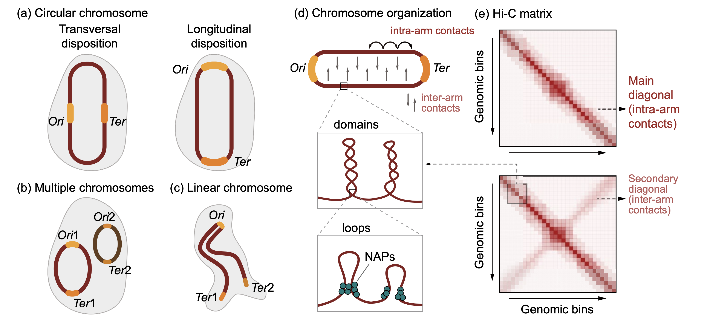
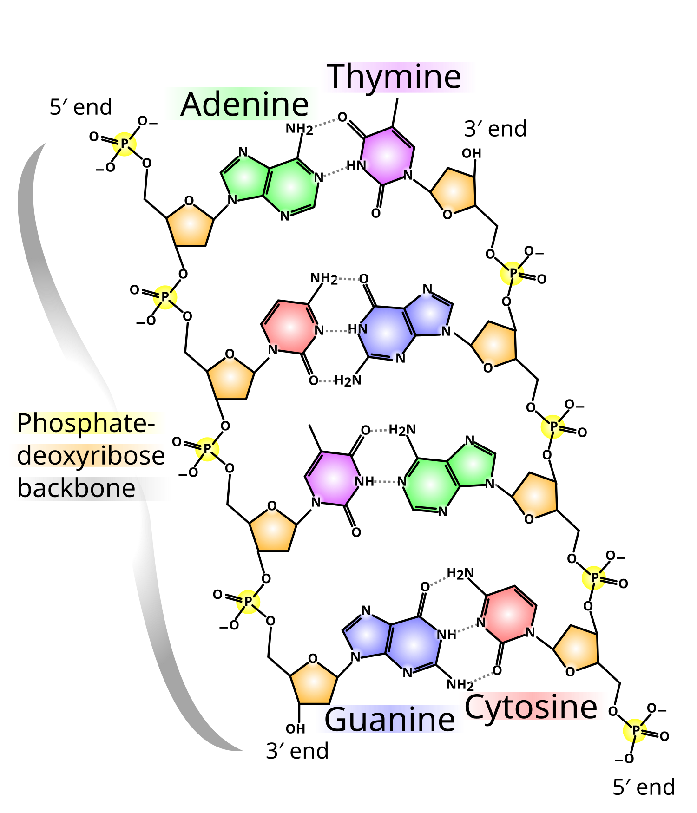
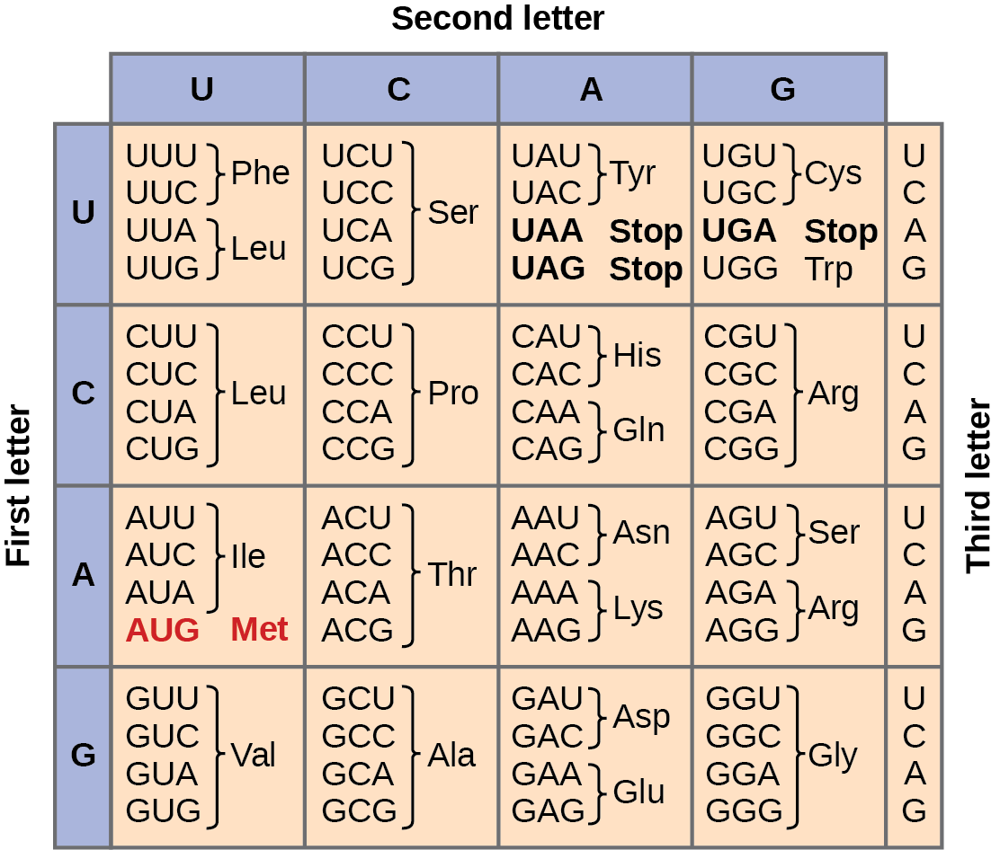
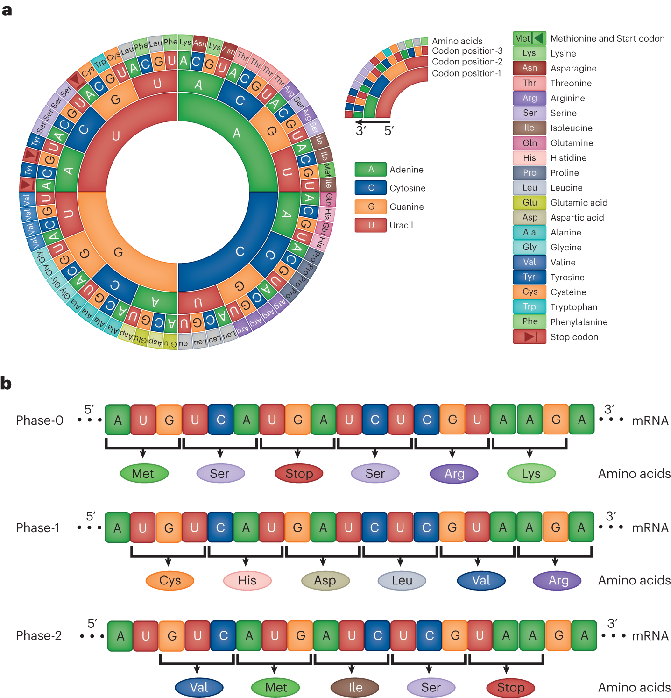
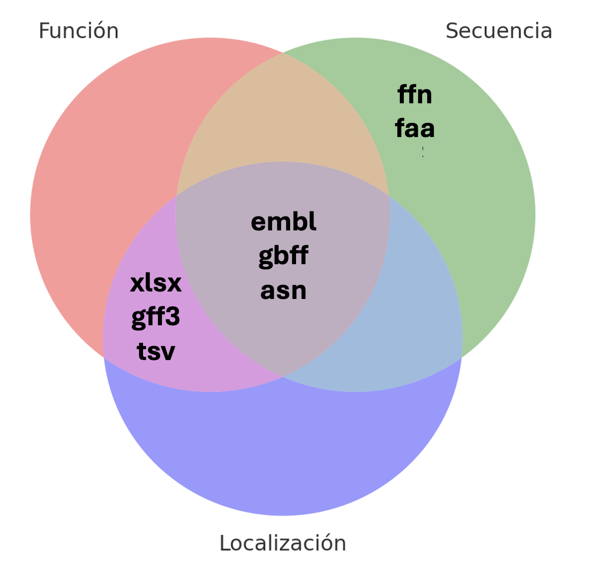
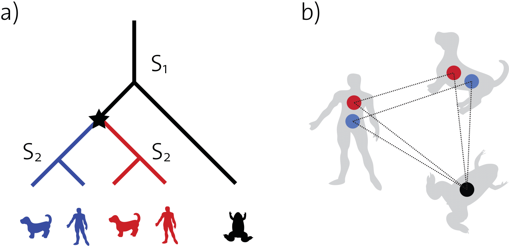
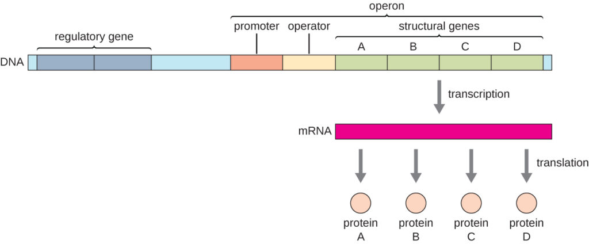
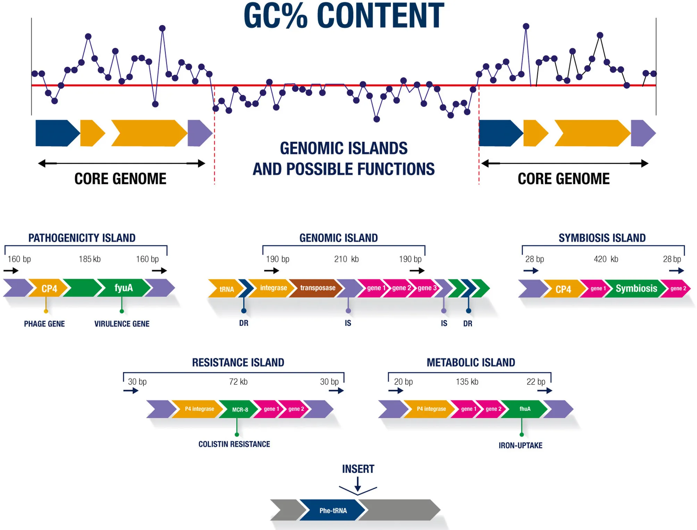
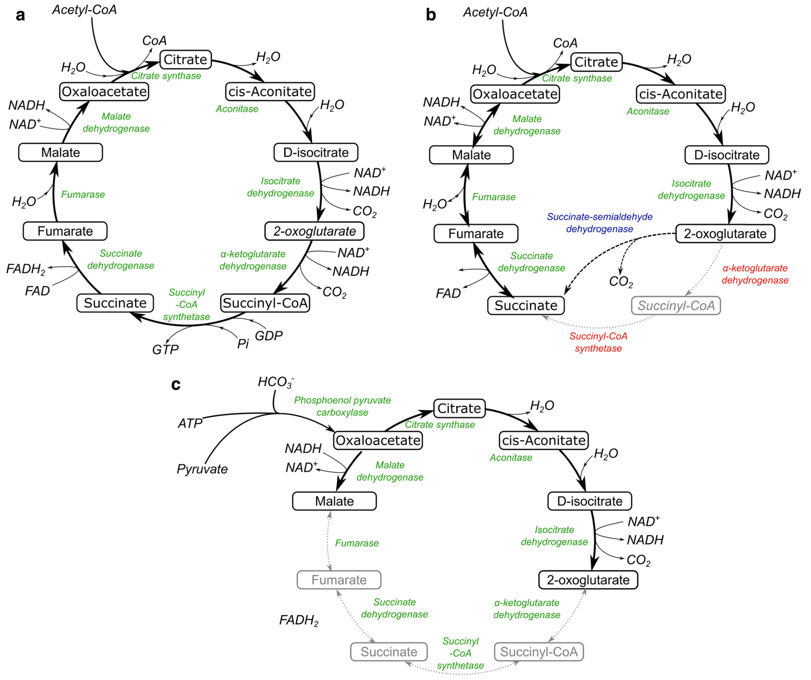
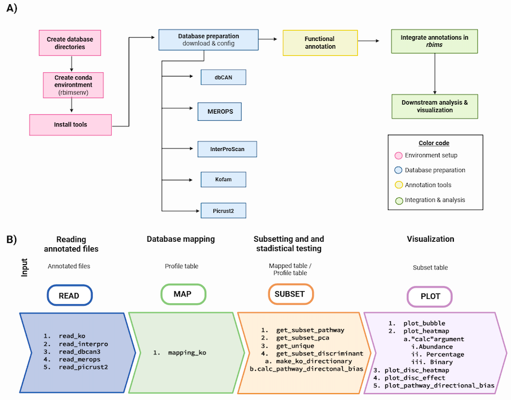

## 01. Predicción de genes y anotación estructural

### 01.1. ¿Qué es la anotación?

La anotación funcional nos permite conocer qué es lo que nuestros microorganismos pueden producir. Es decir, nos permite saber que proteínas, enzimas y metabolitos contienen. A pesar de que comúnmente nos enfocamos únicamente en los genes durante el proceso de anotación, este también nos permite ver varias otras cosas. En general, el proceso de anotación nos ayuda a identificar:

-   **Elementos transcribibles:** Genes (llamados CDS), subunidades del RNA ribosomal (como el 16S) y RNA de transporte (tRNA)

-   **Elementos de control:** Promotores, sitios de unión de represores/activadores, codones de inicio y paro, secuencias Shine-Dalgarno, terminadores y riboswitches.

-   **Elementos de arquitectura:** Secuencias ori y ter y telómeros (en caso de los cromosomas lineales).

-   **Elementos móviles:** Transposones, ICEs y profagos.

-   **Otros elementos:** Sistemas CRISPR-Cas, pseudogenes y proteínas hipotéticas.

{fig-align="center" width="1044"}

### 01.2. Consideraciones generales

La doble hélice de ADN está conformada por dos cadenas individuales pero complementarias. Estas cadenas están conformadas de nucleótidos, los cuales tienen un azúcar de 5 carbonos como base. En el quinto carbono del anillo de la azúcar, se encuentra siempre un fosfato. En el tercer carbono se encuentra un grupo hidroxilo. Al formarse la cadena de ADN, el extremo del nucleótido A que contiene el grupo fosfato (5’) se una al extremo que tiene el grupo hidroxilo del nucleótido B (3’). Este proceso se repite hasta terminar la cadena, por lo que al final quedan un grupo 5’ y un 3’ libres en los extremos.

En la cadena ”líder” estos extremos van del **5’ -\> 3’**

En cadena complementaria, van del **3’ -\> 5’**

{fig-align="center" width="944"}

Esto es importante porque, en general, las bases que nosotros encontramos en nuestros archivos fasta y fastq se encuentran siempre en dirección **5’ -\> 3’**.

------------------------------------------------------------------------

::: callout-tip
#### Ejercicio 1

**Ahora a te toca a ti**

Vamos a empezar un pequeño ejercicio de anotación. Imaginen que ustedes tienen la siguiente secuencia dentro de su archivo fasta:

**5' - ATGAATCGGTACCTGCGAGCAGTGGTAA - 3'**

¿Cual sería la cadena complementaria? ¿Por qué es importante mantener la dirección constante en nuestros archivos?

Tiempo 5 min
:::

------------------------------------------------------------------------

### 01.3. El código genético

Para crear proteínas, es necesario pasar de la secuencia de nucleótidos (leída siempre en sentido 5’ -\> 3’) a una secuencia de aminoácidos. Esto se usando al mRNA como intermediario. Como recordaran, la única diferencia entre el DNA y el mRNA es que este último utiliza la base Uracilo (U) en lugar de Timina (T).

Ahora, dado que la cantidad de aminoácidos (al menos 20) es mayor a la cantidad de nucleótidos (sólo 4), es necesario usar combinaciones de 3 nucleótidos para representar cada aminoácido. A la lista de equivalencias de grupos de 3 nucleótidos a aminoácidos es lo que conocemos como el código genético.

Aunque en algún momento se creyó que el código genético era universal, ahora sabemos que existen variantes, pero la gran mayoría de la bacterias usan la variante 11.

{fig-align="center" width="944"}

Durante la anotación es necesario encontrar los marcos de lectura de un gen. Estos están definidos como la secuencia de nucleótidos que se encuentra entre un codón de inicio (AUG, GUG o UUG) y un codón de paro (UAA, UAG, UGA).

------------------------------------------------------------------------

::: callout-tip
#### Ejercicio 2

**Ahora a te toca a ti**

Vamos a continuar con nuestro ejercicio. Nuestra cadena original era:

**5' - ATGAATCGGTACCTGCGAGCAGTGGTAA - 3'**

Ahora vamos a convertirla a mRNA y buscar codones.

¿Tenemos codones de inicio? ¿Y de paro? ¿Qué aminoácidos tenemos?

Tiempo 10 min
:::

------------------------------------------------------------------------

Durante la anotación es necesario encontrar los marcos de lectura de un gen. Estos están definidos como la secuencia de nucleótidos que se encuentra entre un codón de inicio (AUG, GUG o UUG) y un codón de paro (UAA, UAG, UGA). A estos les llamamos ORFs (open reading frames).

{fig-align="center" width="944"}

### 01.4. ¿Cómo funciona un anotador?

Los anotadores de genomas típicamente usan una variedad de programas de forma lineal (uno tras otro) para ir desde un archivo FASTA hasta los diferentes formatos de los archivos de anotación.

1.  Detección de ORFs (Open Reading Frames) usando todos los marcos de lectura y el código genético adecuado. (*prodigal, glimmer3, GeneMarkS-2*)

2.  Detección de tRNAs, rRNAs y otros otros RNAs no codificantes (ncRNAs). (*barnap, infernal*)

3.  Asignación de funciones de los posibles CDS usando programas de comparación por homología y bases de datos de funciones (posterior a la curación de ORFs). (*diamond, mmseqs2*)

4.  Dependiendo de cada anotador, pasos extras son añadidos, como detección de secuencias CRISPR-Cas, péptidos señales o detección de pseudo-genes, por ejemplo.

**¡Ojo!**

Para asegurarse de tener una buena anotación es necesario tener un buen ensamble (principio Garbage In, Garbage Out).

A pesar de que todas siguen el mismo flujo de trabajo, existen diferentes estrategias de anotación. Estas se pueden dividir en:

**Anotación generalizada:** Esta estrategia hace uso de herramientas con un buen balance entre potencia y velocidad. Hace uso de bases de datos generales para asignar funciones.

**Anotación comprensiva:** Esta estrategia hace uso de varias herramientas redundantes para asegurar que todo sea cubierto. Hace uso de múltiples bases de datos para cubrir la mayor cantidad de funciones.

**Anotación especializada:** Esta estrategia hace uso de herramientas generales en combinación con bases de datos diseñadas y curadas para propósitos específicos (reconstrucción de rutas metabólicas, identificación de factores de virulencia, etc.)

En este ejercicio vamos a utilizar dos anotadores generales, Prokka y Bakta.

### 02. Prokka

[Prokka](https://training.galaxyproject.org/training-material/topics/genome-annotation/tutorials/annotation-with-prokka/slides-plain.html) es una herramienta útil, usa diferentes programas para predecir genes, secuencias codificantes, tRNAs, rRNAs. Hace la traducción de CDS a aminoácidos y asigna funciones usando diferentes bases de datos.

{fig-align="center" width="460"}

::: callout-important
### Sólo para entender la predicción y anotación

En el taller vamos a correr prokka para entender como es el proceso de predicción genica y anotación, sin embargo cada vez se usa menos puesto que no tiene actualizaciones en su base de datos.
:::

Para correrlo vamos a activar el ambiente en el que se aloja.

::: callout-warning
### Activa el ambiente para PROKKA

``` bash
conda activate prokka
```
:::

Tenemos el ambiente activo, ahora vamos a crear un directorio de resultados para prokka.

``` bash
mkdir -p results/14.prokka/0h
```

Y ahora sí le pedimos a prokka que haga a predicción y anotación del MAG que obtuvimos

``` bash
prokka --locustag 0hBin01_Scaffold \
  --prefix 0hBin01 --addgenes --addmrna \
  --cpus 6 --outdir results/14.prokka/0h/0hBin01 \
  results/13.gtdbtk/0h/bins/0hBin01.fasta
```

:::: {.callout-note collapse="true"}
### ¿Y si tuvieras más de un MAG?

Podemos hacer un ciclo que nos permita anotar todos los *bins.*

::: callout-caution
### No lo corras

Este ciclo sólo es un ejemplo de cómo correrlo para todos los bins que tengas y lo podrás usar más adelante en un ejercicio o en los bins o genomas que estés estudiando.
:::

``` bash
#!/bin/bash

# 01. Definimos variables de ubicacion de directorios de entrada y de salida
input="results/13.gtdbtk/0h/bins"
out="results/14.prokka/0h"

# 02. Ejecutamos prokka en todos los fasta
for FASTA in $(ls $input/); do
  LOCUSTAG=$(basename $FASTA .fasta)
  prokka --locustag "${LOCUSTAG}_Scaffold" \
  --prefix $LOCUSTAG --addgenes --addmrna \
  --cpus 6 --outdir "${out}/${LOCUSTAG}" \
  "${input}/${FASTA}" ;
done
```
::::

::: callout-tip
### Explora

Para tener una idea de lo que ocurre cuando ejecutas prokka, toma el ejemplo anterior y anota uno de los bins obtenidos en la muestra que le tocó a tu equipo, el que más te guste, procuren elegir bins distintos.
:::

Desactivemos el ambiente:

``` bash
conda deactivate
```

------------------------------------------------------------------------

### 03. Bakta

[Bakta](https://github.com/oschwengers/bakta) hace el mismo trabajo que Prokka —predice genes (CDS, tRNA, rRNA, ncRNA, CRISPR…) y les asigna función—, pero es una herramienta **actual y activamente mantenida** (Prokka lleva años prácticamente sin actualizarse), y su enfoque cambia en un punto clave. En vez de depender solo de búsquedas por homología, Bakta compara primero las proteínas contra una **base de datos versionada de secuencias proteicas únicas pre-computadas** (identificadas por su hash MD5): si una proteína ya está ahí, hereda de inmediato una anotación de alta confianza con sus referencias cruzadas (KEGG, COG, EC, GO, UniRef); las que no aparecen, pasan a una búsqueda por homología con Diamond.

Las ventajas sobre Prokka son:

-   **Menos "hypothetical protein":** al apoyarse en una base curada y grande, más genes reciben una función informativa en lugar de quedar como "proteína hipotética".

-   **Anotación más rica y trazable:** cada gen trae identificadores estables y referencias cruzadas a varias bases, así que puedes ver anotaciones de KEGG, COG o EC directo en la salida.

-   **Más tipos de elementos y salidas listas para downstream** (`.faa`, `.gff3`, `.gbff`, `.tsv`, `.json`, además de un resumen legible).

El costo es que Bakta necesita una **base de datos grande** (la completa pesa decenas de GB) y **tarda más**: en este MAG de 0 h corrió en \~15 minutos. Por eso en el taller **no lo vamos a correr en vivo**, ya dejamos sus resultados en el directorio de cada quien; de ahí tomaremos el `.faa` (las proteínas predichas) como insumo para las anotaciones que siguen, por ser la anotación más completa y actual.

------------------------------------------------------------------------

::: {.callout-note collapse="true"}
### Asi se corrió (No lo ejecutes)

``` bash
conda activate bakta
```

``` bash
mkdir -p results/15.bakta/0h
```

``` bash
bakta \
    --db /data/BD/bakta_db/db \
    --locus-tag 0hBin01_Scaffold \
    --prefix 0hBin01 \
    --threads 6 \
    --output results/15.bakta/0h/0hBin01/ \
    results/13.gtdbtk/0h/bins/0hBin01.fasta
```
:::

::: callout-important
### Compara (2 min)

Ya tienes el mismo MAG anotado con Prokka (que corriste) y con Bakta (en tu directorio de resultados). En sus resúmenes, ¿cuántos genes quedaron como *hypothetical protein* en cada uno? ¿Por qué crees que difieren, y qué le cuesta a Bakta esa mejora?
:::

------------------------------------------------------------------------

### 03.1 Archivos de salida

El resultado principal de la anotación de genomas es el nombre, secuencia y localización de los genes (Coding sequences, o CDS) y otros elementos que estos contienen. Para representar toda, o parte de esta información pueden usarse diferentes tipos y estructuras de archivos. La diversidad de estos archivos corresponde a la diversidad de usos que se les puede dar. Es decir, cada tipo de archivo fue creado para resolver una necesidad específica. Esto significa que no todos los archivos son equivalentes.

En general, podemos dividir los archivos de salida entre aquellos que contienen la información de la anotación, la secuencia de nucleotidos y/o aminoácidos y los que contienen la localización (*i.e* coordenadas) de los mismos, o una combinación de todos estos.

{fig-align="center" width="944"}

Los archivos más comunes y utilizados son los siguientes:

**ffn/fasta/faa:** Estos son archivos fasta, similares en formato a los que se usan para los contigs, con la diferencia de que estos únicamente cuentan con los CDS (ffn/fasta) o proteínas (faa). Estos archivos son bastante útiles para cuando queremos hacer alineamientos, BLAST u otros análisis que requieren la secuencia de uno o pocos elementos, sin importar su orden.

**xlsx/tsv:** Ambos son archivos tabulares. Cada programa de anotación suele tener su propio formato, pero en general podemos encontrar las funciones y coordenadas de los CDS u otros elementos anotados en tablas de Excel (xlsx) o tablas separadas por tabuladores que pueden abrirse con cualquier programa (tsv). Estos archivos son muy buenos para hacer resúmenes, comparativas generales entre organismos y para ubicar rápidamente funciones de interés.

**gff3:** El formato general de anotaciones versión 3 (gff3) es un formato estándar que contiene 9 columnas con coordenadas y funciones de los CDS y otros elementos. Se puede considerar como un sub-tipo de los tsv y se usa generalmente en conjunto con el archivo fasta/faa de anotación para generar mapas de genes usando librerías de anotación.

Las columnas que se encuentran en el archivo gff3 son: 1- Nombre de la secuencia 2- Base de datos que produjo la anotación 3- Tipo de elemento (CDS, gene, etc…) 4- Inicio 5- Fin 6- Score de alineamiento 7- Cadena 8- Fase (posición del nucleótido en el codón) 9- Atributos (función)

**gbff3:** El formato gbff3 (Genebank flat file format), contiene una gran cantidad de información sobre la localización, función, y ambos tipos de secuencias (nucleótidos y aminoácidos). Debido a la gran cantidad de información que podemos extraer de un archivo gbff3, es el formato de anotación por excelencia y es comúnmente usado para pipelines de filogenomica, anotación extra, etc. Sin embargo, puede llegar a ser un poco complicado de utilizar y la falta de un verdadero estándar de como debe estar formado, puede causar problemas.

**embl:** El formato embl, desarrollado por la ENA (European nucleotide archive) es similar al formato gbff, ya que contiene una gran cantidad de información y tiene la ventaja de que su formato está mucho más estandarizado, por lo que es mucho más fácil de utilizar. A pesar de esto, no es tan comúnmente usado, y su uso principal es para contados programas bioinformaticos que permiten usar este tipo de archivos como *input*.

**asn/json:** Estos formatos suelen contener una gran cantidad de información, incluso más que los formatos gbff o embl. Sin embargo, la información dentro de estos archivos no está estructurada de una forma amigable para ser leída por humanos, por lo que se utilizan principalmente como input para programas especializados.

------------------------------------------------------------------------

::: callout-tip
## Ejercicio 3

**Ahora a te toca a ti**

Basado en los tipos de archivos que vimos, escoge uno para comparar a grandes rasgos los genomas que anotaste con prokka y bakta y responde las siguientes preguntas:

¿Qué archivo elegiste y por qué? ¿Qué métrica usaste para comparar? ¿Cuál fue mejor?

Tiempo 10 min
:::

------------------------------------------------------------------------

## 04.Ortología y anotación de KO, KEGG, eggNOG y Pfam

### 04.1. Ortología, homología y paralogía

Como mencionamos en la sección pasada, el formato gff3 contiene una columna llamada *"score de alineamiento"*. Este score nos indica que tan similar es la secuencia que encontramos a una secuencia conocida y anotada en una base de datos. Sin embargo, una alta similitud (es decir, un buen score) no garantiza que ambas secuencias tengan exactamente la misma función. Para transferir de forma segura la función de un gen conocido a uno de nuestro MAG recién ensamblado, necesitamos distinguir entre *homología, ortología y paralogía*.

-   **Homología:** Es el término general que indica que dos secuencias comparten un **ancestro evolutivo común**. La similitud es el porcentaje observable (ej. 85% de identidad), mientras que la homología es la conclusión evolutiva. En otras palabras, homología denota parentesco. Y debido a esto, es clasificación categórica. Algo es homologo o no lo es, no hay puntos medios.

-   **Ortología:** Son genes homólogos en *diferentes especies* que divergieron debido a un evento de **especiación** (ej. la ADN polimerasa en *E. coli* y en *Bacillus subtilis*). Como simplemente se separaron al ramificarse los linajes, los ortólogos **tienden a conservar la misma función**. La mayoría de los programas de anotación tratan de identificar ortólogos para asignar función a una secuencia.

-   **Paralogía:** Son genes homólogos que surgieron por un evento de **duplicación génica**, lo que significa que pueden existir dentro de un *mismo organismo*. Al duplicarse, una copia suele mantener la función original, mientras que la otra copia queda libre de presión selectiva. Esta copia extra puede acumular mutaciones y desarrollar **funciones nuevas o especializadas** (neofuncionalización/subfuncionalización).

Si una herramienta de anotación se guía únicamente por el mejor *score* de similitud cruda (como un simple BLAST), tu gen podría alinearse maravillosamente con un parálogo. Debido a esto, aunque se parezcan mucho en su secuencia de aminoácidos, su función biológica actual podría ser totalmente distinta, provocando una anotación errónea.

Para resolver este problema, las herramientas y bases de datos funcionales modernas (como KEGG, eggNOG o Pfam) no solo buscan similitud, sino que realizan análisis filogenéticos para agrupar las proteínas en **Grupos Ortólogos (Orthologous Groups)**. Al basarse en la ortología, nos aseguran que la función que le asignamos a nuestra proteína hipotética realmente refleja su verdadero rol biológico en la célula.

------------------------------------------------------------------------

::: callout-tip
## Ejercicio 4

**Ahora a te toca a ti**

Mira y analiza esta filogenia para identificar los pares de genes homologos, ortologos y paralogos.

Tiempo 10 min

{fig-align="center" width="1044"}
:::

------------------------------------------------------------------------

### 04.2. Bases de datos.

Ahora que ya sabemos cómo se hacen las comparativas, necesitamos una base de datos con los genes y proteínas que queremos usar como base para la comparación.

Existen muchas bases de datos, la mayoría de las cuales están basadas en proteínas con función conocida de forma experimental (o con una inferencia informática bastante cuidadosa). Además, las bases de datos suelen organizar estas proteínas de forma racional, en vías metabólicas comunes, por funciones generales, etc..., de acuerdo con las necesidades de quienes las hicieron. Entre las bases de datos más comunes se encuentran KO, KEGG, COG, eggNOG y Pfam. Cada una tiene un enfoque particular para estructurar y clasificar la inmensa diversidad genética:

1.  **KEGG (Kyoto Encyclopedia of Genes and Genomes)**: Es mucho más que un simple catálogo de secuencias; es un conjunto integral de bases de datos diseñado para entender los sistemas biológicos de alto nivel. Su mayor fortaleza son los mapas de vías metabólicas (*KEGG Pathways*), los cuales ilustran gráficamente cómo interactúan las moléculas y enzimas dentro de una célula para realizar funciones biológicas complejas, desde el ciclo de Krebs hasta la degradación de hidrocarburos.

2.  **KO (KEGG Orthology)**: Es el sistema de clasificación específico que utiliza KEGG para vincular los genes individuales de cualquier organismo con las vías metabólicas generales. Un identificador KO (por ejemplo, *K00873*) agrupa a todos los genes ortólogos de diferentes especies que catalizan exactamente la misma reacción funcional. En la práctica, cuando anotas un genoma, buscas asignarle un número KO a cada gen para saber exactamente qué "nodo" o paso de un mapa metabólico de KEGG es capaz de realizar tu organismo.

3.  **COG (Clusters of Orthologous Groups)**: Fue uno de los primeros sistemas pioneros en clasificar las proteínas de genomas completos en grupos evolutivos. Su mayor legado, y la razón por la que lo seguimos mencionando hoy en día, es la creación de las categorías funcionales amplias representadas por una sola letra. Por ejemplo, la categoría **\[C\]** agrupa genes encargados de Energy production and conversion, y la **\[G\]** agrupa los de Carbohydrate transport and metabolism. Aunque la base de datos original de COG ya no se actualiza con la misma frecuencia que antes, su sistema de clasificación por letras sigue siendo el estándar universal.

4.  **eggNOG (evolutionary genealogy of genes: Non-supervised Orthologous Groups)**: Es la evolución moderna, automatizada y escalable del sistema clásico COG. eggNOG construye grupos de ortólogos basándose en análisis filogenéticos masivos a diferentes niveles taxonómicos (abarcando miles de genomas y permitiendo búsquedas desde todo el dominio Bacteria hasta linajes muy específicos). Al heredar y expandir las categorías funcionales de COG, esta base de datos es la herramienta predilecta para hacer resúmenes y gráficos del perfil funcional completo de un MAG, dándote una visión global de lo que "sabe hacer" ese microorganismo.

5.  **Pfam (Protein families)**: A diferencia de KEGG, COG o eggNOG, Pfam no intenta clasificar o anotar la proteína completa, sino que se enfoca en identificar sus dominios proteicos. Utiliza Modelos Ocultos de Markov (HMMs) para reconocer los "bloques de construcción" evolutivos (módulos estructurales o funcionales) de una secuencia. Esto es crucial porque los genes a menudo se fusionan o intercambian partes. Pfam te permite diseccionar la arquitectura de tu proteína y descubrir si tiene, por ejemplo, un dominio catalítico conocido unido a un dominio regulador completamente nuevo.

------------------------------------------------------------------------

::: callout-tip
## Ejercicio 5

**Ahora a te toca a ti**

Qué tipo de bases de datos te parecen más adecuadas para los siguientes casos:

1.  Quiero saber qué porcentaje del genoma de mi MAG está dedicado a la "producción de energía" y al "metabolismo de carbohidratos".

2.  Encontré que mi MAG tiene muchas "proteínas hipotéticas" y quiero saber que podrían hacer estas.

3.  Quiero hacer un análisis comparativo para saber si todas mis MAGs cuentan con el ciclo de TCA completo

Tiempo 10 min
:::

------------------------------------------------------------------------

### 04.3. Ejecución de los anotación especializada

Con las proteínas predichas por Bakta ya podemos hacerles preguntas más específicas. Como ya vimos, existen varias bases de datos especializadas, y **cada una responde algo distinto**; conviene tener claro el mapa antes de correrlas:

::: callout-note
#### ¿Qué pregunta responde cada herramienta?

-   **KofamScan (KEGG):** ¿qué **rutas metabólicas** puede llevar a cabo este organismo? (asigna números KO, que se mapean a rutas)

-   **EggNOG-mapper:** ¿a qué **ortólogos / categorías COG** pertenecen sus genes? Función amplia y **comparable entre genomas**.

-   **CAZy / dbCAN:** ¿qué **enzimas activas sobre carbohidratos** tiene? Clave en un fermento de maíz, donde degradar el almidón es central.

-   **antiSMASH:** ¿tiene **clústeres de genes biosintéticos** para metabolitos secundarios (antibióticos, bacteriocinas…)?

En el taller correremos **KofamScan** en vivo y antiSMASH en web; las demás las platicamos.
:::

------------------------------------------------------------------------

### 05. KofamScan

[KofamScan](https://github.com/takaram/kofam_scan) es una herramienta de anotación, usa la base de datos KOfam de [KEGG](https://www.genome.jp/kegg/pathway.html) para obtener información sobre los genes que participan en diferentes rutas metabólicas.

Puedes mapear los resultados de kofam en [KEGGMapper](https://www.genome.jp/kegg/mapper/search.html)

Para correrlo necesitamos activar el ambiente donde vive kofam

``` bash
conda activate annot_fun
```

Y ahora sí correrlo

``` bash
mkdir -p results/16.kofam/0h
```

``` bash
exec_annotation results/15.bakta/0h/0hBin01/0hBin01.faa -o results/16.kofam/0h/0hBin01.txt --report-unannotated --cpu 6 --tmp-dir results/16.kofam/0h/tmp -p  /data/BD/kofam/profiles/ -k  /data/BD/kofam/ko_list
```

Borramos el directorio temporal para liberar espacio

``` bash
rm -r results/16.kofam/0h/tmp
```

Y desactivamos el ambiente

``` bash
conda deactivate
```

::: callout-caution
### Veamos los resultados

Descarga el resultado de esta anotación y explorémoslos en [KEGGMapper](https://www.genome.jp/kegg/mapper/search.html)
:::

::: {.callout-note collapse="true"}
### Para correrlo con muchos genomas

Creamos el script para kofam

``` bash
# 01. Creamos el directorio para alojar los resultados
mkdir -p results/16.kofam/0h/

# 02. Lo corremos
for FAA in $(ls results/15.bakta/0h/*/*.faa); do
    name=$(basename $FAA .faa)
    exec_annotation $FAA \
        -o results/16.kofam/0h/"$name.txt" \
        --report-unannotated \
        --cpu 6 \
        --tmp-dir results/16.kofam/0h/"tmp$name" \
        -p /data/BD/kofam/profiles/ \
        -k /data/BD/kofam/ko_list
done

# 03. remover los directorios temporales
rm -r results/16.kofam/0h/tmp*
```
:::

::: callout-caution
**Ahora tú: anota todos tus MAGs con KofamScan**

Ya corriste Kofam sobre un MAG. Ahora genera los `.txt` de **todos los bins de la muestra de tu equipo** — los vas a necesitar en el análisis global. Usa el `.faa` de **Bakta** (pre-computado en tu directorio) como entrada. Apóyate en el script del callout *"Para correrlo con muchos genomas"* de arriba.

Al terminar, deberías tener un `.txt` por cada MAG en `results/16.kofam/<tu_muestra>/`. Verifica con `ls` que estén todos antes de seguir.
:::

------------------------------------------------------------------------

### 06. EggNOG

[EggNOG-mapper](http://eggnog-mapper.embl.de/) asigna función a las proteínas a partir de **ortólogos**: genes que descienden de un ancestro común y que, por lo tanto, tienden a conservar la misma función. La herramienta compara cada proteína contra la base **eggNOG**, que agrupa genes en familias de ortólogos (**COG** y sus equivalentes) a distintos niveles taxonómicos, y le transfiere la anotación desde el ortólogo más específico que encuentra.

Genera una anotación **amplia y comparable entre genomas**: además de una descripción funcional, cada gen recibe su categoría **COG**, y referencias cruzadas a **GO, KEGG, EC, CAZy y Pfam**, entre otras. Por eso es una de las anotaciones más usadas cuando quieres comparar el repertorio funcional de varios organismos bajo un mismo marco.

::: {.callout-note collapse="true"}
### Así se corre (no lo ejecutes)

``` bash
mkdir -p results/17.eggnog/0h
nohup emapper.py --cpu 10 -m diamond --itype proteins --evalue 0.00001 \
     -i results/15.bakta/0h/0hBin01/0hBin01.faa \
     --output_dir results/17.eggnog/0h -o 0hBin01 \
     --decorate_gff yes --report_orthologs \
     --data_dir /data/BD/eggnog/emapperdb-5.0.2/ &
```
:::

------------------------------------------------------------------------

### 07. CAZy

[Cazy](https://www.cazy.org/) es una base de datos especializada en enzimas que actúan sobre carbohidratos, esta base de datos se actualiza constantemente y es curada por una comunidad científica que busca dominios funcionales basados en evidencia experimental. Cuentan con [CAZypedia](https://www.cazypedia.org/index.php/Main_Page) para informar especificidades de cada familia cazy.

En el pozol, las CAZymes que degradan almidón del maíz son especialmente relevantes.

------------------------------------------------------------------------

### 08. antiSMASH

Dentro de los genomas microbianos, podemos encontrar algunas regiones específicas que participan en la biosíntesis de metabolitos secundarios, estas secciones se conocen como Clústeres de Genes Biosintéticos, que son relevantes debido a las posibles aplicaciones que pueden tener, por ejemplo: actividades antimicrobianas, antitumorales, reductoras del colesterol, antivirales, etc.

Los Clústers de genes, u operones, son regiones del genoma que contienen multiples genes, prácticamente pegados unos a otros, todos los cuales son controlados por reguladores (promotores, enhancer, etc...).

{fig-align="center" width="944"}

Las islas genomicas son similares a los operones, con la diferencia de que con la diferencia de que son segmentos de ADN mucho más grandes (generalmente entre 10 y 200 kilobases) y, lo más importante, han sido adquiridos a través de transferencia horizontal de genes (HGT).

Mientras que un operón es una unidad funcional de transcripción que típicamente evoluciona junto con el organismo, una isla genómica es un "paquete" de información genética foránea que el microorganismo incorporó de otra especie (por ejemplo, a través de plásmidos, fagos o transformación). Debido a esto, las islas genómicas suelen tener características únicas que delatan su origen externo, tales como:

-   Un porcentaje de GC y un uso de codones diferente al promedio del resto del genoma.

-   Suelen estar flanqueadas por secuencias de inserción, o contener en su interior genes que permitieron su integración original en el cromosoma, como integrasas y transposasas.

{fig-align="center" width="944"}

Los Clústeres de Genes Biosintéticos (BGCs) son un tipo de operón, que a veces pueden ser parte de una isla genomica. A pesar de que los productos que generan no son estrictamente necesarios para la supervivencia del organismo (metabolismo secundario), son bastante útiles para mejorar el "fitness" del mismo.

[antiSMASH](https://antismash.secondarymetabolites.org/#!/start) usa modelos ocultos de Markov que permiten identificar los grupos de genes contenidos en las secuencias genómicas que codifican BGCs de todas las clases químicas conocidas.

Si te interesa saber más a fondo cómo anotar BGCs en los genomas de tu interés puedes aprender siguiendo el flujo de análisis propuestos en la lección de [Minería Genómica](https://carpentries-incubator.github.io/genome-mining/) de Software Carpentry.

## 09. Reconstrucción metabólica

Una vez que hemos asignado identificadores funcionales, como los números KO, a las secuencias de nuestro MAG, el siguiente paso es realizar una reconstrucción metabólica. Este proceso consiste en integrar esas anotaciones individuales dentro de redes bioquímicas para inferir las capacidades de nuestro microorganismo, su posible importancia ecológico y su estilo de vida. Por ejemplo, con la reconstrucción metabólica podemos saber su tipo de respiración, si tiene la capacidad de fijación de nitrógeno o las vías de síntesis de aminoácidos que utiliza.

{fig-align="center" width="1044"}

La reconstrucción metabólica va más allá de un simple conteo de genes, estando más enfocada en evaluar el contexto de las vías bioquímicas a través de un proceso de 4 etapas:

1.  **Mapeo a redes de referencia:** Se relacionan los números KO, EC o Reactome anotados con mapas metabólicos globales estandarizados (como KEGG Pathways, KEGG Modules, MetaCyc o BioCyc).

2.  **Evaluación de completitud de módulos (Pathway Completeness):** Se determina qué porcentaje de los pasos secuenciales de una ruta metabólica está presente en el genoma. Un módulo se considera funcionalmente completo si cuenta con todas las enzimas clave del bloque sintético o degradativo.

3.  **Análisis de brechas (Gap-filling):** Identifica pasos ausentes en una ruta. Si a un operón o vía lineal le falta una sola enzima intermedia, esta ausencia puede deberse a la fragmentación del ensamblaje del MAG (cobertura incompleta del genoma) o a que el organismo utiliza una variante enzimática no canónica.

4.  **Inferencia de fenotipos y perfiles biogeoquímicos:** Agrupa las vías en grandes categorías ecológicas como el ciclo del nitrógeno (desnitrificación, anammox, fijación), ciclo del azufre, metanogénesis, fijación de carbono y resistencia a metales pesados.

### 09.1. Herramientas para reconstrucción metabólica

Hacer la reconstrucción del metabolismo a mano es increíblemente laborioso y pesado. Por eso se usan herramientas bioinformaticas para semi-automatizar este proceso a partir de archivos de anotación (*.gff3, .faa* o tablas de *eggNOG/KEGG*). Entre las herramientas más útiles para esto se encuentran las siguientes:

1.  **KEGG Mapper / Reconstruct:** Interfaz que toma listas de identificadores KO y colorea las rutas metabólicas de KEGG, permitiendo visualizar qué nodos de la red están presentes en tu organismo.

2.  **METABOLIC:** Es un pipeline de linea de comando que integra la anotación funcional con la cobertura metagenómica para cuantificar la contribución potencial de cada MAG a los ciclos biogeoquímicos globales.

3.  **MicrobeAnnotator:** Pipeline similar a METABOLIC, que extrae anotaciones de múltiples bases de datos para calcular porcentajes de completitud de módulos de KEGG y rutas metabólicas generales.

4.  **RbiMs (Reconstruction of Bin Metabolisms):** Un paquete de R especializado en la integración, perfilamiento y visualización de vías metabólicas para MAGs. Importa directamente los resultados de anotación (KEGG vía KofamScan, dbCAN, InterProScan, etc.), calcula el porcentaje de cobertura de cada vía y permite extraer subconjuntos de datos metabólicos de manera programática. Al correr de forma nativa en R, facilita la integración de metadatos experimentales, la generación de gráficas y la aplicación de análisis para identificar vías diferencialmente enriquecidas.

{fig-align="center" width="944"}
