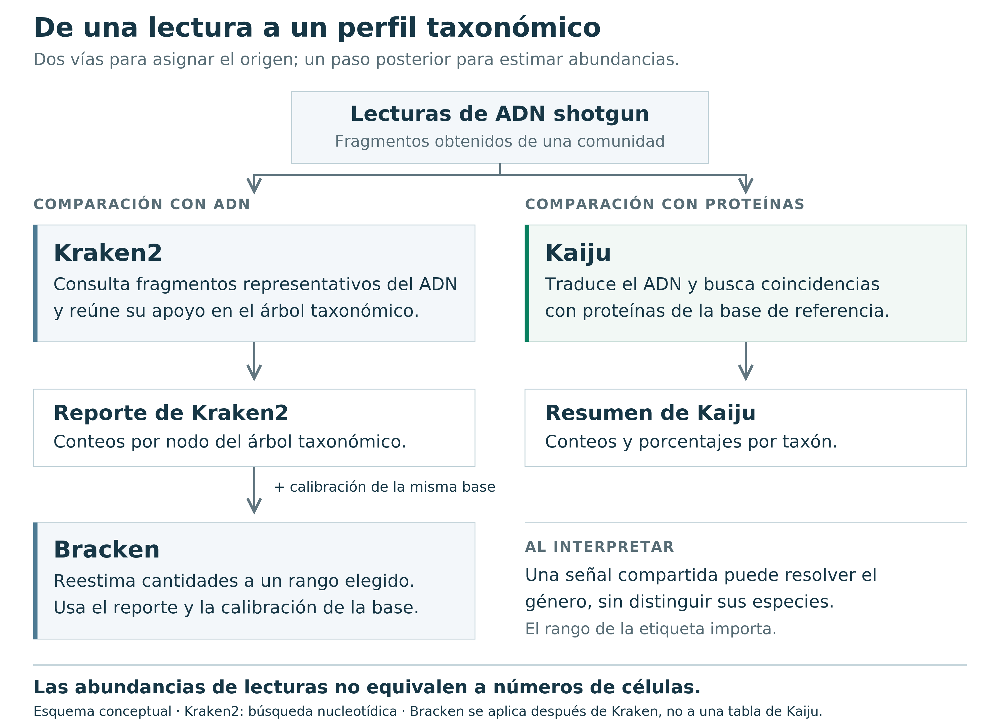
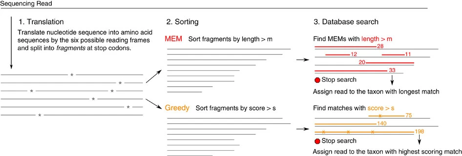
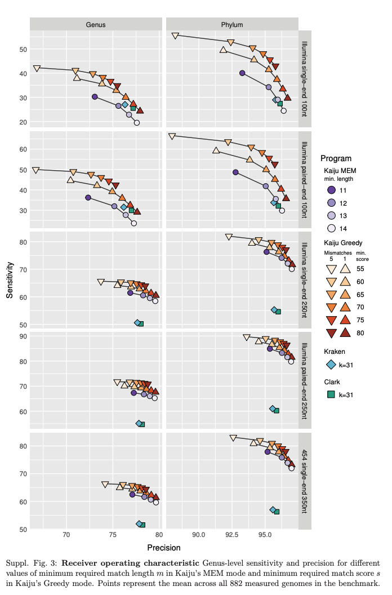
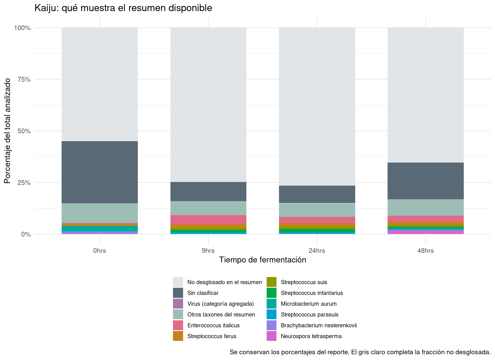
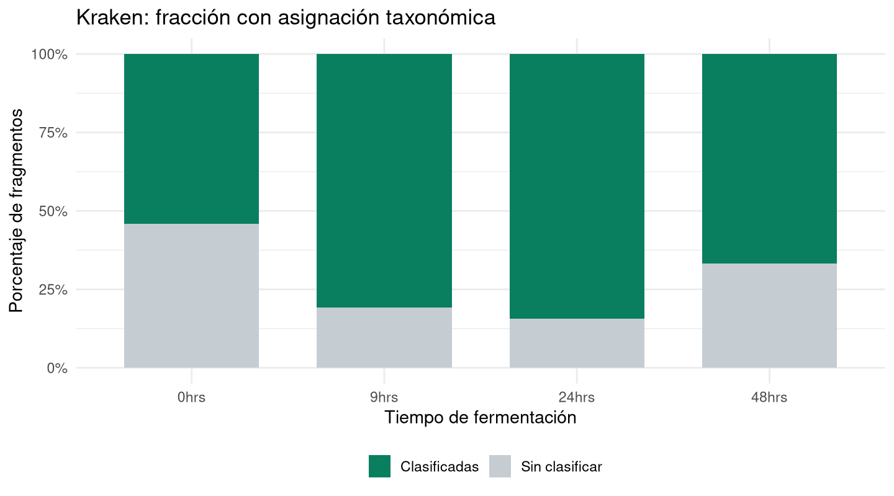
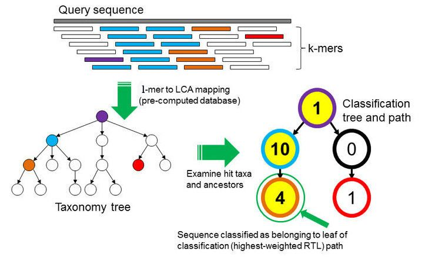

En las prácticas anteriores trabajamos con lecturas de **metagenómica shotgun del pozol**: ADN de una comunidad asociada a una fermentación de maíz. Aquí exploraremos los perfiles taxonómicos de **0, 9, 24 y 48 horas**. Los archivos conservan sus nombres originales: `0hrs`, `9hrs`, `24hrs` y `48hrs`.

La pregunta es **qué organismos están representados en esas secuencias y cómo cambia su representación entre tiempos**. Una asignación taxonómica es una comparación contra referencias; no constituye por sí sola una medición del número de células ni demuestra que un organismo esté vivo.

**Recorrido de la práctica:** copiar reportes → reconocer sus tablas → producir dos gráficos en R → explorar la jerarquía taxonómica en Pavian → interpretar los límites de los resultados.

::: {.callout-important}
### Aquí empieza la parte ejecutable

Los clasificadores **ya se ejecutaron**. Esta práctica comienza en [1. Ubícate en tu proyecto](#inicio-practica), y continúa con [2. Copia los resultados preparados](#copiar-insumos). Trabajaremos con esos reportes desde nuestra cuenta del servidor. Los [ejemplos completos de ejecución de Kaiju y Kraken2–Bracken](#ejecutar-clasificadores) quedan disponibles al final para utilizarlos en tus propios proyectos; **no se ejecutan durante esta clase**.
:::

## ¿Qué hicieron Kaiju, Kraken y Bracken?

Un metagenoma contiene **fragmentos de ADN de muchos organismos mezclados**. Las lecturas no vienen con el nombre de su organismo: lo inferimos comparándolas con secuencias conocidas, organizadas en una **base de referencia**. En esta práctica analizamos ADN shotgun; no estamos agrupando amplicones de 16S.

Conviene separar dos preguntas: **«¿de dónde puede venir este fragmento?»** y **«¿cuánto representa cada grupo en la muestra?»**. Clasificar ayuda a responder la primera; resumir y estimar abundancias, la segunda. Una lectura no equivale a una célula.

| Herramienta | Qué hace | Qué tenemos para esta práctica |
|---|---|---|
| **Kaiju** | Traduce lecturas y busca coincidencias con proteínas de referencia. Puede reconocer similitudes que se han conservado a nivel proteico. | Resumen por taxón, matriz de conteos y metadatos. |
| **Kraken2** | Usa coincidencias de secuencia basadas en k-mers/minimizadores para asignar fragmentos a la taxonomía de su base de referencia. | Un reporte `.kreport` por tiempo, con una jerarquía de clados. |
| **Bracken** | Reestima abundancias a un rango elegido a partir de resultados de Kraken y distribuciones precalculadas para su base de datos. | Se explica como paso posterior. **Los `.kreport` disponibles son resultados de Kraken, no resultados de Bracken.** |

**La idea de cada método, en palabras sencillas:**

- **Kraken2 reúne pistas del ADN.** Busca pequeñas partes representativas de la secuencia —minimizadores de los *k-mers*— y combina su apoyo para asignar un taxón. Es una forma rápida de consultar la referencia. El parámetro `confidence` exige apoyo a la asignación; no expresa la probabilidad de que una especie esté presente.
- **Kaiju busca semejanzas en proteínas.** Traduce el ADN en los seis marcos de lectura posibles y compara los fragmentos resultantes con proteínas conocidas. ADN diferente puede codificar los mismos aminoácidos: eso ayuda a reconocer relaciones conservadas, aunque no siempre distingue especies cercanas. Traducir ADN no demuestra actividad ni expresión.
- **Bracken reestima cantidades después de Kraken.** Algunas lecturas solo se asignan a un grupo amplio. Bracken combina esos conteos con cómo se espera que Kraken clasifique fragmentos de los genomas de referencia. Así estima abundancias a un rango elegido; no confirma el origen individual de cada lectura ambigua.



**¿Por qué una lectura puede quedar en género y no en especie?** Si dos especies comparten el fragmento observado, la evidencia puede respaldar únicamente el grupo que las contiene: su ancestro común más bajo, o **LCA**. Mantener esa asignación más amplia evita forzar una precisión que los datos no permiten.

**¿Cuál elegir?** Depende de la pregunta y de las referencias disponibles. Kraken2–Bracken es una opción para construir perfiles de abundancia; Kaiju aporta una comparación complementaria mediante proteínas. Comprueba los resultados con controles o comunidades conocidas y compara el mismo rango y denominador. **Una lista más larga de especies no demuestra un análisis mejor:** puede incluir asignaciones falsas. Ninguno compensa por completo una base inadecuada.

Esta síntesis sigue los fundamentos de [Kraken2](https://doi.org/10.1186/s13059-019-1891-0), [Kaiju](https://doi.org/10.1038/ncomms11257) y [Bracken](https://doi.org/10.7717/peerj-cs.104); los manuales de ejecución se enlazan al final.

<details>
<summary>Para profundizar: búsqueda proteica, sensibilidad y precisión de Kaiju</summary>



Cambiar el modo de búsqueda o la longitud mínima de coincidencia modifica el equilibrio entre encontrar más coincidencias y evitar asignaciones erróneas. Esta figura del material original ilustra una evaluación del método; **no es un resultado de nuestras cuatro muestras de pozol**. Consulta el [manual de Kaiju](https://github.com/bioinformatics-centre/kaiju) para los parámetros y la publicación original.

{width=560}

</details>

## 1. Ubícate en tu proyecto {#inicio-practica}

En **Visual Studio Code conectado al servidor**, abre la carpeta `reads2mags_pozol` que ya utilizaste para filtrado, ensamble y binning. Luego abre **Terminal → New Terminal**. Comprueba que la ventana indique una conexión remota por SSH y que la terminal corresponda a tu cuenta.

Si seguiste la organización de la sección de espacio de trabajo, el proyecto estará dentro de `~/curso_metagenomica_2026/bitacora/reads2mags_pozol/`. Los bloques de esta página usan esa organización y `$HOME`, que se sustituye por la carpeta de tu propia cuenta. No escribas el nombre de usuario de otra persona. Si tu proyecto está en otra ubicación, confirma la ruta con el docente antes de continuar.

**Terminal de VS Code — Bash:**

```bash
cd "$HOME/curso_metagenomica_2026/bitacora/reads2mags_pozol" &&
pwd &&
ls -d data results
```

`pwd` debe terminar en `/reads2mags_pozol`, y debes reconocer `data/` y `results/`. Si estás dentro de otra carpeta del proyecto, vuelve a abrir la raíz y crea allí la terminal.

| Carpeta del proyecto | Uso en esta sección |
|---|---|
| `data/` | Conserva los insumos iniciales de las otras prácticas. |
| `results/07.kaiju/` | Reportes de Kaiju y las tablas y figuras que produciremos a partir de ellos. |
| `results/08.kraken/` | Reportes de Kraken y sus nuevas tablas y figuras. |
| `scripts/` | Nuestro archivo `08_taxonomia.R`. |
| `outs/` | Registro de ejecución y versiones de R y sus paquetes. |

**Todos los comandos siguientes parten de esta raíz.** No cambiaremos de directorio dentro de R ni entraremos a `results/07.kaiju/` para ejecutar el script.

## 2. Copia los resultados preparados {#copiar-insumos}

Copia los reportes preparados a la carpeta de resultados de tu proyecto.

**Terminal de VS Code — Bash:**

```bash
mkdir -p "$HOME/curso_metagenomica_2026/bitacora/reads2mags_pozol/results" \
         "$HOME/curso_metagenomica_2026/bitacora/reads2mags_pozol/scripts" \
         "$HOME/curso_metagenomica_2026/bitacora/reads2mags_pozol/outs"
cp -r --update=none /home/pcb_01/reads2mags_pozol/results/07.kaiju \
                    /home/pcb_01/reads2mags_pozol/results/08.kraken \
                    "$HOME/curso_metagenomica_2026/bitacora/reads2mags_pozol/results/"
ls -lh "$HOME/curso_metagenomica_2026/bitacora/reads2mags_pozol/results/07.kaiju/" \
       "$HOME/curso_metagenomica_2026/bitacora/reads2mags_pozol/results/08.kraken/"
```

`mkdir -p` crea las carpetas que falten y conserva las existentes. `--update=none` conserva también los archivos que ya existan con el mismo nombre; esta copia **no elimina otros resultados**. Los nuevos archivos pertenecen a tu cuenta.

Debes encontrar estos **ocho archivos iniciales**:

| En `results/07.kaiju/` | Qué contiene |
|---|---|
| `kaiju_summary.tsv` | Una tabla larga: muestra, porcentaje, conteo, identificador y nombre taxonómico. |
| `matrix.tsv` | Una fila por entrada taxonómica y una columna de conteos por tiempo. |
| `metadata.tsv` | Correspondencia entre los nombres de las muestras y sus etapas. |
| `generate_matrix.R` | Script con el que se reorganizó el resumen como matriz. La matriz ya está incluida. |

En `results/08.kraken/`: `0hrs_sm.kreport`, `9hrs_sm.kreport`, `24hrs_sm.kreport` y `48hrs_sm.kreport`.

Si aparece `Permission denied` al leer `/home/pcb_01/`, comparte el mensaje con el docente. Ese problema corresponde al acceso a los insumos compartidos.

## 3. Reconoce las tablas antes de graficar

**Terminal de VS Code — Bash:**

```bash
column -t -s $'\t' "$HOME/curso_metagenomica_2026/bitacora/reads2mags_pozol/results/07.kaiju/kaiju_summary.tsv" | less -S
```

`column` alinea las columnas separadas por tabulaciones, conservando los espacios de los nombres. Usa las flechas para desplazarte y **`q` para salir**. `less -S` conserva cada registro en una línea; los linajes largos se recorren con **← y →**. Si no se ve el encabezado, pulsa **`g`** para volver al comienzo. Identifica las columnas `file`, `percent`, `reads`, `taxon_id` y `taxon_name`.

Después abre la matriz:

```bash
column -t -s $'\t' "$HOME/curso_metagenomica_2026/bitacora/reads2mags_pozol/results/07.kaiju/matrix.tsv" | less -S
```

Sal con **`q`** y consulta los metadatos:

```bash
column -t -s $'\t' "$HOME/curso_metagenomica_2026/bitacora/reads2mags_pozol/results/07.kaiju/metadata.tsv" | less -S
```

Sal de los metadatos con **`q`** para recuperar la terminal.

La matriz tiene **1,180 filas de datos** y las columnas `Taxonomy`, `0hrs`, `9hrs`, `24hrs` y `48hrs`. Son entradas del resumen, **no 1,180 especies confirmadas**: también hay categorías como `unclassified` y `Viruses`.

**Dos preguntas para leer correctamente estos datos:**

1. **¿Qué significa un cero?** Que esa entrada no tiene conteos en la matriz de esa muestra. El resumen preparado aplicó un filtro de conteo; un cero puede representar una entrada excluida por el filtro. No demuestra ausencia biológica.
2. **¿Cuál es el denominador?** Los porcentajes guardados en `kaiju_summary.tsv` se refieren al total analizado por Kaiju. Las filas disponibles suman aproximadamente **45.08%, 25.23%, 23.53% y 34.69%**, respectivamente. Por eso, dividir cada columna de `matrix.tsv` entre su suma cambiaría la pregunta a «¿cómo se reparte lo que quedó en esta tabla?».

::: {.callout-note}
### La taxonomía tiene jerarquía, pero los linajes no tienen una longitud fija

Las cadenas de `Taxonomy` incluyen entre 1 y 16 componentes separados por `;`. No podemos llamar «familia» a la sexta posición o «género» a la séptima de todas las filas. Para un gráfico por familia necesitaríamos una correspondencia explícita entre identificadores y rangos. Aquí conservaremos el **nombre terminal de cada entrada del resumen**, sin inventar sus rangos.
:::

## 4. Prepara y guarda el script de R desde la terminal

### Activa el entorno compartido

Todos los bloques ejecutables de este apartado se pegan **abajo, en la terminal Bash de VS Code**, donde aparece el nombre de tu cuenta y el signo `$`. Activamos el entorno que contiene R y sus paquetes. Usarlo aquí no ejecuta un análisis de QIIME 2.

```bash
conda activate /data/env/qiime2
command -v Rscript
Rscript --version
Rscript -e 'p <- c("ggplot2", "dplyr", "scales"); print(sapply(p, requireNamespace, quietly = TRUE))'
```

La ruta debe ser `/data/env/qiime2/bin/Rscript`, y los tres paquetes deben indicar `TRUE`. Repite la activación al abrir una terminal nueva. Si falta un paquete, avisa al docente para resolverlo en la instalación compartida.

**No abras una consola interactiva con `R`.** Ejecutaremos el archivo completo con `Rscript`. Tampoco hay que pegar las líneas de R individualmente en Bash.

### Crea y guarda el archivo con un solo bloque

El bloque siguiente **crea y guarda** `scripts/08_taxonomia.R` en tu proyecto. Púlsalo con **Copiar**, pégalo completo en la terminal y pulsa **Enter**. Incluye la línea final `RSCRIPT`, sola y sin espacios delante. Las líneas entre `cat` y `RSCRIPT` son el contenido del archivo R; no se ejecutan durante este paso.

El primer gráfico utiliza los porcentajes del resumen de Kaiju y muestra en gris la fracción no desglosada. El segundo utiliza las filas `R` y `U` de Kraken para distinguir fragmentos clasificados y sin clasificar sin contar varias veces los clados.

**Terminal de VS Code — crear y guardar el script:**

```bash
mkdir -p "$HOME/curso_metagenomica_2026/bitacora/reads2mags_pozol/scripts" \
         "$HOME/curso_metagenomica_2026/bitacora/reads2mags_pozol/outs"

cat > "$HOME/curso_metagenomica_2026/bitacora/reads2mags_pozol/scripts/08_taxonomia.R" <<'RSCRIPT'
# Ejecutar desde la raíz del proyecto reads2mags_pozol.
library(ggplot2)
library(dplyr)
stopifnot(capabilities("png"), capabilities("cairo"))
theme_set(theme_minimal(base_size = 13))

# 1. Leer las tablas y comprobar el orden de las cuatro muestras.
matriz <- read.delim("results/07.kaiju/matrix.tsv", check.names = FALSE)
meta <- read.delim("results/07.kaiju/metadata.tsv", check.names = FALSE)
muestras <- c("0hrs", "9hrs", "24hrs", "48hrs")
stopifnot(identical(names(matriz)[-1], muestras),
          setequal(meta[[1]], muestras), !anyDuplicated(meta[[1]]))
print(dim(matriz))
print(meta)

# 2. Usar los porcentajes originales del resumen de Kaiju.
kaiju <- read.delim("results/07.kaiju/kaiju_summary.tsv")
kaiju$sample <- sub("\\.out$", "", basename(kaiju$file))
kaiju$Taxon <- sub(".*;", "", sub(";+$", "", kaiju$taxon_name))
kaiju$Taxon[kaiju$Taxon == "unclassified"] <- "Sin clasificar"
kaiju$Taxon[kaiju$Taxon == "Viruses"] <- "Virus (categoría agregada)"
print(aggregate(percent ~ sample, kaiju, sum))

principales <- kaiju |>
  filter(!Taxon %in% c("Sin clasificar", "Virus (categoría agregada)")) |>
  group_by(Taxon) |>
  summarise(total = sum(percent), .groups = "drop") |>
  slice_max(total, n = 8, with_ties = FALSE) |>
  pull(Taxon)

perfil <- kaiju |>
  mutate(Taxon = if_else(Taxon %in% c(principales, "Sin clasificar",
    "Virus (categoría agregada)"), Taxon, "Otros taxones del resumen")) |>
  group_by(sample, Taxon) |>
  summarise(Porcentaje = sum(percent), .groups = "drop")
resto <- perfil |>
  group_by(sample) |>
  summarise(Porcentaje = 100 - sum(Porcentaje),
    Taxon = "No desglosado en el resumen", .groups = "drop")
stopifnot(all(resto$Porcentaje >= 0))
perfil <- bind_rows(perfil, resto)
perfil$sample <- factor(perfil$sample, levels = muestras)
perfil$Taxon <- factor(perfil$Taxon, levels = c("No desglosado en el resumen",
  "Sin clasificar", "Virus (categoría agregada)", "Otros taxones del resumen", principales))
colores <- c(setNames(hcl.colors(8, "Dark 3"), principales),
  "Otros taxones del resumen" = "#9CBEB5", "Sin clasificar" = "#596976",
  "Virus (categoría agregada)" = "#AA77AA", "No desglosado en el resumen" = "#E1E5E8")

p_kaiju <- ggplot(perfil, aes(sample, Porcentaje / 100, fill = Taxon)) +
  geom_col(width = 0.7) +
  scale_fill_manual(values = colores) +
  scale_y_continuous(labels = scales::label_percent()) +
  labs(x = "Tiempo de fermentación", y = "Porcentaje del total analizado",
    fill = NULL, title = "Kaiju: qué muestra el resumen disponible",
    caption = "Se conservan los porcentajes del reporte. El gris claro completa la fracción no desglosada.") +
  theme(legend.position = "bottom", legend.text = element_text(size = 9)) +
  guides(fill = guide_legend(ncol = 2))
ggsave("results/07.kaiju/01_perfil_kaiju.png", p_kaiju, device = grDevices::png,
       width = 11, height = 8, dpi = 160, bg = "white", type = "cairo")
write.csv(perfil, "results/07.kaiju/perfil_kaiju.csv", row.names = FALSE)

# 3. Leer los cuatro reportes de Kraken sin contar dos veces los clados.
kraken <- data.frame()
for (muestra in muestras) {
  archivo <- paste0("results/08.kraken/", muestra, "_sm.kreport")
  reporte <- read.delim(archivo, header = FALSE, quote = "", comment.char = "")
  names(reporte) <- c("Porcentaje", "Clado", "Directas", "Rango", "TaxID", "Nombre")
  resumen <- subset(reporte, Rango %in% c("U", "R"))
  stopifnot(nrow(resumen) == 2, setequal(resumen$Rango, c("U", "R")))
  kraken <- rbind(kraken, data.frame(sample = muestra,
    Estado = ifelse(resumen$Rango == "U", "Sin clasificar", "Clasificadas"),
    Fragmentos = resumen$Clado))
}
kraken <- kraken |>
  group_by(sample) |>
  mutate(Proporcion = Fragmentos / sum(Fragmentos)) |>
  ungroup()
kraken$sample <- factor(kraken$sample, levels = muestras)
print(kraken)
p_kraken <- ggplot(kraken, aes(sample, Proporcion, fill = Estado)) +
  geom_col(width = 0.7) +
  scale_y_continuous(labels = scales::label_percent()) +
  scale_fill_manual(values = c("Clasificadas" = "#097F5F", "Sin clasificar" = "#C5CDD3")) +
  labs(x = "Tiempo de fermentación", y = "Porcentaje de fragmentos", fill = NULL,
    title = "Kraken: fracción con asignación taxonómica") +
  theme(legend.position = "bottom")
ggsave("results/08.kraken/02_clasificacion_kraken.png", p_kraken, device = grDevices::png,
       width = 9, height = 5, dpi = 160, bg = "white", type = "cairo")
write.csv(kraken, "results/08.kraken/resumen_clasificacion.csv", row.names = FALSE)
writeLines(capture.output(sessionInfo()), "outs/08_taxonomia_sesion.txt")
stopifnot(all(file.info(c("results/07.kaiju/01_perfil_kaiju.png",
                         "results/08.kraken/02_clasificacion_kraken.png"))$size > 0))
cat("LISTO: se guardaron las dos figuras y las dos tablas.\n")
RSCRIPT

ls -lh "$HOME/curso_metagenomica_2026/bitacora/reads2mags_pozol/scripts/08_taxonomia.R"
```

La última instrucción debe mostrar el archivo con un tamaño mayor que cero. **Ya está guardado; no necesitas Ctrl + S para este método.** Si la terminal sigue mostrando `>` y no regresa al indicador de tu cuenta, comprueba que pegaste también la línea final `RSCRIPT`. Ese `>` puede ser la continuación de Bash, no una consola de R.

Puedes abrir después `scripts/08_taxonomia.R` desde el Explorador de VS Code para leerlo. Si editas su contenido arriba, guarda con **Ctrl + S** antes de repetir la ejecución. Volver a pegar el bloque de creación sustituye el contenido de ese script; los reportes de entrada se conservan.

## 5. Ejecuta y abre tus figuras

Una vez creado el archivo, pega el siguiente bloque **en la misma terminal Bash**, con el entorno `qiime2` activo. `cd` establece la carpeta de trabajo; `Rscript` inicia R, ejecuta todo el archivo y termina. El registro se guarda en `outs/` y después se muestra en pantalla:

```bash
cd "$HOME/curso_metagenomica_2026/bitacora/reads2mags_pozol" &&
Rscript --vanilla "$HOME/curso_metagenomica_2026/bitacora/reads2mags_pozol/scripts/08_taxonomia.R" \
  > "$HOME/curso_metagenomica_2026/bitacora/reads2mags_pozol/outs/08_taxonomia.log" 2>&1

cat "$HOME/curso_metagenomica_2026/bitacora/reads2mags_pozol/outs/08_taxonomia.log"
```

La última línea debe decir **`LISTO: se guardaron las dos figuras y las dos tablas.`** Si aparece un error, el registro contiene el mensaje que necesitamos para resolverlo. Si aparece `No such file or directory` para el script, vuelve al bloque de creación del apartado 4; no hay un análisis en marcha. Los mensajes de `dplyr` sobre funciones con nombres coincidentes son informativos. Mientras R trabaja puede no aparecer texto en pantalla. Guarda siempre el script si lo editaste antes de repetir la ejecución.

En el **Explorador de VS Code**, abre con un clic:

1. `results/07.kaiju/01_perfil_kaiju.png`.
2. `results/08.kraken/02_clasificacion_kraken.png`.

Las figuras se guardan en PNG para verlas directamente desde VS Code. El mismo script genera `perfil_kaiju.csv`, `resumen_clasificacion.csv` y el registro `outs/08_taxonomia_sesion.txt`. Al repetirlo se actualizan **esas salidas del ejercicio**, conservando los reportes de entrada.

### ¿Qué deberías observar?



La fracción gris clara domina parte de las barras porque el resumen disponible no desglosa todo el material analizado. **No es una comunidad compuesta principalmente por un taxón llamado «Otros»**. Es una limitación del resumen que debe quedar visible al interpretar las proporciones.



Kraken clasifica aproximadamente **54.21%, 80.83%, 84.36% y 66.71%** de los fragmentos en 0, 9, 24 y 48 horas. Es una propiedad de la combinación muestra–referencia–clasificador, **no un índice de diversidad ni una medida de biomasa**. Con lecturas pareadas, el reporte contabiliza fragmentos o pares, no necesariamente cada extremo R1/R2 por separado.

**Discute:** ¿el cambio entre barras refleja un cambio de comunidad, de posibilidad de clasificar las secuencias o de ambos? ¿Qué información adicional necesitaríamos para distinguirlos?

## 6. Explora la jerarquía de Kraken en Pavian



Un `.kreport` contiene seis columnas sin encabezado:

| Columna | Significado |
|---|---|
| 1 | Porcentaje del total asignado al clado. |
| 2 | Fragmentos del clado, incluyendo sus descendientes. |
| 3 | Fragmentos asignados directamente a ese nodo. |
| 4 | Rango: `U` sin clasificar, `R` raíz, `D` dominio, `P` filo, `C` clase, `O` orden, `F` familia, `G` género y `S` especie, entre otros. |
| 5 | Identificador taxonómico. |
| 6 | Nombre, con sangría para representar la jerarquía. |

**No sumes todos los clados del reporte**: una especie está incluida en su género, familia y demás ancestros. Para comparar familias se selecciona un mismo rango, no todos los niveles a la vez.

1. En el explorador remoto de VS Code, abre `results/08.kraken/`.
2. Selecciona **los cuatro archivos `.kreport`**, pulsa el botón derecho y elige **Download / Descargar**. Guarda las copias en una carpeta local que puedas reconocer.
3. En el navegador de tu computadora, abre [Pavian](https://fbreitwieser.shinyapps.io/pavian/).
4. En **Data Input → Upload files / Browse**, carga los cuatro reportes. Usa tus archivos, no el conjunto de ejemplo de la aplicación.
5. Revisa **Results Overview** para reconocer las muestras y sus fracciones clasificadas. En **Sample**, selecciona una muestra y explora el diagrama de Sankey. Usa **Comparison** para contrastar las muestras a un mismo rango.

El grosor de una rama representa la cantidad asignada a ese clado; no implica interacción ecológica entre organismos. Comprueba el rango y el denominador mostrados antes de comparar paneles.

Si el servicio web no está disponible, las dos figuras generadas en R y los reportes locales permiten continuar la discusión. Pavian es un visor de estos resultados; no vuelve a ejecutar Kraken.

## 7. Interpreta y registra lo que aprendiste

Las muestras permiten **describir diferencias de representación taxonómica entre los cuatro tiempos**. Esas diferencias son compatibles con cambios de la comunidad durante la fermentación, pero los reportes por sí solos no establecen su causa ni la actividad de cada organismo.

Tenemos un perfil por tiempo y los metadatos entregados no documentan réplicas biológicas independientes. **Estas cuatro muestras no bastan para una prueba del efecto general del tiempo de fermentación**. Para inferir ese efecto necesitaríamos fermentaciones independientes, un diseño que contemple las mediciones repetidas y metadatos pertinentes.

En tu bitácora escribe respuestas breves:

1. ¿Qué entradas del reporte cambian más entre tiempos? Distingue lo observado de la explicación biológica que propones.
2. ¿Qué significan y qué no significan «sin clasificar» y «no desglosado»?
3. ¿Qué tendría que cambiar en los insumos para comparar familias de Kaiju con familias de Kraken o Bracken?

**Conclusión defendible:** podemos comparar los perfiles reportados y reconocer sus límites de cobertura y resolución. No podemos convertir estos porcentajes en abundancias celulares absolutas, interpretar un cero como ausencia comprobada ni atribuir diferencias al tiempo con una prueba inferencial sin el diseño y la replicación necesarios.

### Síntesis por equipos

Formen **tres equipos**. Si son dos, el primero combina las tareas A y B y el segundo desarrolla C; ambos deben revisar las dos figuras.

| Equipo | Evidencia que revisa | Pregunta que debe resolver |
|---|---|---|
| A | Perfil de Kaiju y sus porcentajes | ¿Qué cambia entre tiempos y qué limita el resumen parcial? |
| B | Kraken y Pavian al mismo rango | ¿Qué linajes cambian y cómo influye la fracción sin clasificar? |
| C | Evidencias de ambos equipos | ¿Qué proceso podría explicarlo y qué experimento permitiría distinguirlo de otra explicación? |

Cada equipo prepara una síntesis de **150 a 200 palabras** y una explicación oral de **tres minutos**. Incluyan dos observaciones con tiempo, taxón, valor y denominador; una interpretación ecológica; una explicación alternativa; y una hipótesis futura con una predicción medible. Distingan las fermentaciones independientes de las lecturas y de las submuestras.

Al final, elaboren entre todos una conclusión y una propuesta de muestreo: qué medirían, qué compararían, qué repetirían de forma independiente y qué resultado debilitaría su hipótesis. Las observaciones de este ejercicio sirven para formularla; su comprobación requiere nuevos datos con replicación.

## 8. Ejecuta los clasificadores en tus propios proyectos {#ejecutar-clasificadores}

::: {.callout-note}
### Material de referencia: no se ejecuta en esta clase

Estos ejemplos conservan la organización `data/`, `results/`, `scripts/` y `outs/`. En VS Code, crea el archivo `.sh` indicado, pega el código y guarda con **Ctrl + S**. Después se ejecuta con **Bash en la terminal remota**, desde la raíz del proyecto. VS Code es el editor; el cómputo ocurre en el servidor.
:::

Antes de usarlos, activa el entorno que contenga cada herramienta. Por ejemplo, `conda activate kaiju` corresponde únicamente a un entorno que se llame `kaiju`; los nombres disponibles dependen del servidor. Sustituye las rutas `/ruta/real/...` por las bases instaladas y ajusta los nombres de las muestras. Los ejemplos usan pares `data/0hrs_sm_R1.fastq` y `data/0hrs_sm_R2.fastq`, y el mismo patrón para 9, 24 y 48 horas. En tu proyecto deben ser las lecturas que hayas seleccionado después del control de calidad.

**Usa estos bloques en el proyecto de tus nuevos datos:** producen archivos con los nombres indicados y pueden sustituir salidas previas. Los reportes del taller se conservan para el recorrido de las secciones 1–7. Los dos hilos del ejemplo deben ajustarse a los recursos asignados; la memoria requerida depende de la base. Si el clúster utiliza un gestor de trabajos, ejecuta los scripts mediante ese sistema.

<details>
<summary>Kaiju: clasificar pares, añadir nombres y generar el resumen</summary>

**Editor de VS Code — archivo `scripts/07_kaiju.sh`:**

```bash
#!/usr/bin/env bash
set -euo pipefail

db="/ruta/real/base_kaiju"
indice="$db/kaiju_db_nr_euk.fmi"
out="results/07.kaiju"
hilos=2
mkdir -p "$out" outs

for sample in 0hrs 9hrs 24hrs 48hrs; do
  kaiju -t "$db/nodes.dmp" -f "$indice" \
    -i "data/${sample}_sm_R1.fastq" \
    -j "data/${sample}_sm_R2.fastq" \
    -o "$out/${sample}.out" \
    -z "$hilos" -a mem -m 13

  kaiju-addTaxonNames -t "$db/nodes.dmp" -n "$db/names.dmp" \
    -i "$out/${sample}.out" -u -p \
    -o "$out/${sample}_names.out"
done

kaiju2table -t "$db/nodes.dmp" -n "$db/names.dmp" \
  -p -c 50 -r species -o "$out/kaiju_summary.tsv" \
  "$out/0hrs.out" "$out/9hrs.out" \
  "$out/24hrs.out" "$out/48hrs.out"
```

**Terminal de VS Code — Bash, después de guardar:**

```bash
mkdir -p outs
bash scripts/07_kaiju.sh > outs/07_kaiju.log 2>&1
```

`-a mem -m 13` selecciona MEM y una coincidencia mínima de 13 aminoácidos. Ajusta `indice` al archivo `.fmi` de tu base; `nodes.dmp` y `names.dmp` deben corresponder a ella. En `kaiju-addTaxonNames`, `-u` omite los no clasificados **solo del archivo con nombres**; el resumen utiliza los `.out` originales.

En `kaiju2table`, `-r species` resume a nivel de especie, `-p` incluye el linaje y `-c 50` filtra por conteo mínimo. No se añade `-u` a este comando: los no clasificados siguen formando parte del denominador de sus porcentajes. Conserva el resumen completo recién generado; no supongas que contiene exactamente las mismas filas que el archivo parcial del taller.

Si tienes el script `generate_matrix.R` distribuido en esta práctica, la transformación del resumen a matriz se ejecuta desde la raíz:

```bash
Rscript results/07.kaiju/generate_matrix.R \
  results/07.kaiju/kaiju_summary.tsv > results/07.kaiju/matrix.tsv
```

Este conversor requiere el paquete `tidyr` y usa los nombres de los archivos para las columnas. Comprueba esas columnas y prepara metadatos que coincidan con las muestras de tu proyecto.

</details>

<details>
<summary>Kraken2: clasificar pares y guardar un reporte por muestra</summary>

**Editor de VS Code — archivo `scripts/08_kraken2.sh`:**

```bash
#!/usr/bin/env bash
set -euo pipefail

db="/ruta/real/base_kraken2"
out="results/08.kraken"
hilos=2
mkdir -p "$out" outs

for sample in 0hrs 9hrs 24hrs 48hrs; do
  kraken2 --db "$db" --threads "$hilos" \
    --paired --use-names --confidence 0.10 \
    --report "$out/${sample}_sm.kreport" \
    --output "$out/${sample}_sm.kraken.reads.tsv" \
    "data/${sample}_sm_R1.fastq" "data/${sample}_sm_R2.fastq"
done
```

**Terminal de VS Code — Bash, después de guardar:**

```bash
mkdir -p outs
bash scripts/08_kraken2.sh > outs/08_kraken2.log 2>&1
```

`--paired` procesa juntos R1 y R2; `--report` produce el resumen jerárquico y `--output` conserva las asignaciones por fragmento. El umbral `--confidence 0.10` es un parámetro del ejemplo, **no una probabilidad de que la especie esté presente** ni un valor universal. Mantén el formato estándar del reporte para usarlo con Bracken. Las lecturas pareadas deben corresponderse y estar en el mismo orden.

</details>

<details>
<summary>Bracken: reestimar abundancias a un rango taxonómico</summary>

Bracken necesita **la misma base de Kraken2 que originó el reporte** y una distribución preparada para la longitud de lectura elegida. El ejemplo de 75 bases requiere `database75mers.kmer_distrib`; cambia `longitud` según tus lecturas y la distribución correspondiente. Si esta falta, debe prepararse para esa misma base siguiendo el [manual de Bracken](https://github.com/jenniferlu717/Bracken). No se puede usar cualquier base disponible con los reportes del taller.

**Editor de VS Code — archivo `scripts/08_bracken.sh`:**

```bash
#!/usr/bin/env bash
set -euo pipefail

db="/ruta/real/base_kraken2"
longitud=75
nivel="C"
out="results/08.kraken/bracken"

test -r "$db/database${longitud}mers.kmer_distrib" || {
  echo "Falta la distribución de Bracken para esta longitud y base." >&2
  exit 1
}
mkdir -p "$out" outs

for sample in 0hrs 9hrs 24hrs 48hrs; do
  bracken -d "$db" \
    -i "results/08.kraken/${sample}_sm.kreport" \
    -o "$out/${sample}_sm.bracken.${nivel}.tsv" \
    -r "$longitud" -l "$nivel" -t 10
done
```

**Terminal de VS Code — Bash, después de guardar:**

```bash
mkdir -p outs
bash scripts/08_bracken.sh > outs/08_bracken.log 2>&1
```

`C` indica clase; puedes elegir `F` para familia, `G` para género o `S` para especie. `-t 10` fija el umbral de conteo previo a la reestimación. Compara resultados al mismo rango y revisa su denominador: la fracción estimada de Bracken no es una abundancia celular absoluta.

</details>

En cualquier ejecución, revisa el archivo `.log` correspondiente en `outs/`. Para que tu análisis pueda repetirse, registra las versiones de los programas, la fecha y composición de las bases de referencia, los archivos de entrada y los parámetros. **Estos ejemplos muestran cómo ejecutar el flujo; no afirman reproducir exactamente los reportes históricos con otra base o versión.**

## Referencias y procedencia

- [Organización del proyecto y VS Code](https://mariafer-florido.github.io/reads2mags-v1/02.Espacio_de_trabajo.html), [filtrado](https://mariafer-florido.github.io/reads2mags-v1/03.Filtrados.html), [ensambles](https://mariafer-florido.github.io/reads2mags-v1/04.Ensambles.html) y [binning](https://mariafer-florido.github.io/reads2mags-v1/05.Binning.html): se conserva su estructura `data/`, `results/`, `scripts/` y `outs/`.
- [Kaiju: manual y formato de resúmenes](https://github.com/bioinformatics-centre/kaiju).
- [Kraken2: formato de los reportes](https://github.com/DerrickWood/kraken2/blob/master/docs/MANUAL.markdown).
- [Bracken: requisitos para reestimar abundancias](https://github.com/jenniferlu717/Bracken).
- [Pavian: manual de exploración](https://github.com/fbreitwieser/pavian/blob/master/vignettes/MANUAL.md).
- [VS Code: trabajo remoto por SSH](https://code.visualstudio.com/docs/remote/ssh).

Las figuras de los algoritmos se conservaron del material original del curso. Las dos figuras de resultados de esta versión se regeneran con el código visible y los ocho archivos distribuidos desde `pcb_01`. Los parámetros históricos de preparación indicaban `kaiju2table -r species -p -c 50`; el resumen conservado es parcial y se utiliza tal como está, sin reconstruir categorías no disponibles.
